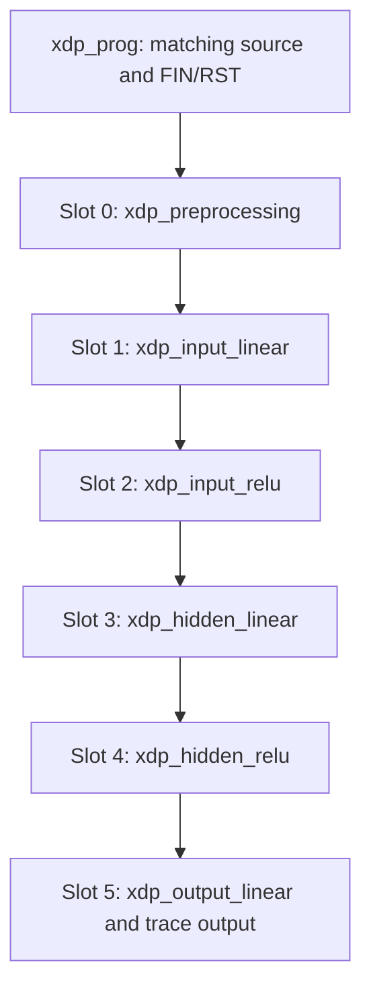

# Repository baseline and runner summary

## Purpose and current status

This repository runs a flow-based neural-network detector in Linux XDP/eBPF.
The baseline uses the quantized parameters already present in the repository;
retraining is a separate reproducibility exercise.

An end-to-end smoke run has succeeded: XDP attached, parameters were initialized,
TCP traffic reached the detector, a final-stage prediction was logged, and cleanup
checks passed. This establishes an execution baseline, **not model accuracy or
numerical correctness**. The historical results are recorded below.

## Repository components

| Path | Responsibility |
| --- | --- |
| [src/xdp.c](src/xdp.c) | Userspace loader: loads BPF programs, populates the tail-call map, selects the initial model slot, and attaches XDP to the interface argument. |
| [src/xdp.bpf.c](src/xdp.bpf.c) | Packet handling, source-IP filtering, inference stages, and timing/prediction output. |
| [src/handler.bpf.h](src/handler.bpf.h) | Updates per-flow statistics and internal timing counters. |
| [src/common.h](src/common.h) | Flow keys, feature/intermediate state, and the flow hash map. |
| [src/params.bpf.h](src/params.bpf.h) | Model layout and pinned parameter/index maps. |
| [src/mlp.bpf.h](src/mlp.bpf.h) | Integer normalization, linear layers, and ReLU arithmetic. |
| [src/mlp_params.bpf.h](src/mlp_params.bpf.h) | Quantized weights and normalization constants used by the updater. |
| [src/hot_updating.c](src/hot_updating.c) | Writes parameters into the inactive model slot, then changes the active index. |
| [src/mlp_train.py](src/mlp_train.py), [src/mlp_quant.py](src/mlp_quant.py), [src/mlp.py](src/mlp.py) | Training, quantization, and PyTorch model code; not invoked by the runner. |
| [dataset/](dataset/), [dataset-instance/](dataset-instance/) | Dataset files and traffic-instance directories. |
| [libbpf/](libbpf/), [bpftool/](bpftool/) | Vendored BPF tooling and libraries. |
| [Makefile](Makefile), [src/Makefile](src/Makefile) | Build the dependencies and detector executables, respectively. |
| [run-baseline.sh](run-baseline.sh) | Standalone Bash smoke-test orchestration, logging, verification, and cleanup. |

## Detector behavior

The entry program processes matching IPv4/TCP traffic from **33.33.33.73**.
It maintains directional flow statistics and triggers inference on a FIN or RST.
Its six input features, in model order, are maximum TCP-segment length, maximum
inter-packet duration, minimum TCP-segment length, destination port, accumulated
TCP-header length, and packet count. Segment length is computed as IPv4 total
length minus IPv4 header length; it is not application-payload length.

The network has six inputs, two hidden layers of 32 units each, and two output
scores. Integer arithmetic uses 16 fractional bits. The tail-call sequence is:



`flow_map` holds flow features and intermediate activations. The `progs` program
array connects the stages. `/sys/fs/bpf/nn_parameters` provides two model slots;
`/sys/fs/bpf/nn_idx` selects the active slot. The loader initializes the index to
1; a successful first updater invocation writes slot 0 and switches to it.
The detector passes packets onward with `XDP_PASS`; a prediction is not a packet
blocking decision.

## Build and run

Use an **isolated Linux VM**, not a production host. Required facilities include
kernel BTF at `/sys/kernel/btf/vmlinux`, XDP/BPF support, mounted bpffs at
`/sys/fs/bpf`, and readable, enabled kernel tracing. Building requires the
vendored dependency trees, Make, a C toolchain, `clang-12` with BPF support, and
libelf/zlib development libraries. The current build assumes x86-64 include paths.

From the repository root, build without sudo:

```bash
make
make -C src
```

Dependency outputs go into `.output/`; detector outputs go into `src/.output/`,
including `xdp`, `hot_updating`, the generated kernel header, and the BPF skeleton.
Generated targets have order-only output-directory prerequisites, so a clean
build creates `src/.output` before writing files.

Inspect the runner and perform a non-root preflight:

```bash
./run-baseline.sh --help
./run-baseline.sh --check
```

Non-root preflight cannot establish root-only BPF, pin, or trace permissions.
The following root preflight checks those prerequisites without creating the lab
network; the second command performs the actual smoke test:

```bash
sudo ./run-baseline.sh --check
sudo ./run-baseline.sh
```

The runner requires Bash, Python 3's standard library, iproute2, Make, GNU
coreutils, and util-linux. It does not require netcat or Python packages. It
requires current executables and checks build freshness; it does not build them.

For a longer per-stage timeout and persistent logs outside the repository:

```bash
sudo ./run-baseline.sh \
  --timeout 30 \
  --log-dir "$HOME/nn-ebpf-baseline-$(date +%Y%m%d-%H%M%S)"
```

The log directory must be **new**, with an existing parent. The timeout accepts
1–300 seconds and defaults to 20. Exit zero means smoke success, or preflight
success when `--check` was specified; it does not certify the model.

## Runner workflow and safety

The temporary network uses these fixed names and addresses to match the source
filter without editing the detector:

| Location | Interface | IPv4 address |
| --- | --- | --- |
| Host namespace | `ids-server` | `33.33.33.1/24` |
| `ids-client` namespace | `ids-client0` | `33.33.33.73/24` |

The runner performs these operations in order:

1. Checks tools, binaries, build freshness, lab-name availability, overlapping
   non-default IPv4 routes, and, under root, existing model pins and BPF access.
2. Takes a single-runner lock and creates the namespace/veth network.
3. Starts trace capture, then launches the detector on `ids-server`.
4. Verifies the actual XDP attachment, all six tail-call entries, and that the
   pinned model maps belong to the inference chain. Stage names may be exact full
   BTF names or exact 15-character kernel names; wrong names/types still fail.
5. Runs the updater, verifies the active-slot switch, and compares every active
   parameter byte with the header. It also rejects zero normalization divisors.
6. Opens a TCP listener on port 5001, sends `hello\n` from the client namespace,
   explicitly sends a FIN, and verifies the server response.
7. Requires a new final-stage timing/prediction message, then cleans up.

On success, failure, Ctrl+C, or SIGTERM, cleanup attempts to stop its children,
checks XDP detachment and model pins, and removes its network. The loader receives
SIGINT because it does not install a SIGTERM handler. Residual pins are removed
only when their recorded map IDs still match. Unknown/replaced pins are left in
place and cause failure; they must not be blindly deleted. Forced termination
such as SIGKILL or a VM crash cannot run these cleanup traps.

The runner does **not** edit source/model files, retrain, install packages, mount
filesystems, change sysctls, or switch to generic XDP if attachment fails. It
creates logs/runtime artifacts and temporary networking; an unheld lock file may
remain at `/run/nn-ebpf-baseline.lock` after exit.

Do not run another detector, updater, or trace reader concurrently. The original
loader uses fixed global pin paths and unconditionally attempts to remove them
on its cleanup path; the runner's lock does not coordinate unrelated programs.
`trace_pipe` is shared: reading consumes records, although the runner does not
clear or reconfigure tracing. Attribution of a matching trace line to this test
assumes no competing detector emits the same message.

## Logs and evidence

The runner prints its log-directory path. By default, it creates
`/tmp/nn-ebpf-baseline.XXXXXX`. Files are retained on success and failure and,
under normal sudo invocation, ownership is returned to the invoking user.
`/tmp` is not archival storage: use a persistent `--log-dir` for reproducibility.
Some files below exist only if execution reached their corresponding stage.

| Artifact | What it records |
| --- | --- |
| `run.log` | Timestamped progress, commands, verification results, cleanup, and final status. |
| `detector.log` | Loader/libbpf output and BPF loading or attachment diagnostics. |
| `updater.log` | Model-updater output and index transition. |
| `trace.log` | Kernel trace records, including final inference output. May also contain unrelated/historical records. |
| `trace-reader.log` | Trace-reader errors. |
| `server.log` | Received greeting, source address, and observed client FIN. |
| `state.json` | Entry-program metadata, map metadata, initial index, and attachment snapshot; not feature values or per-layer outputs. |
| `active-model.json` | Raw and BTF-formatted contents of the selected parameter slot after updating. |
| `pins.json` | Recorded model-map IDs used to guard residual-pin cleanup. |
| `server-address.json`, `client-addresses.json` | Lab interface/address snapshots. |
| `programs-before.json` | BPF programs visible before the run, when checked as root. |
| `net-after.json` | Attachment state after loader exit and before veth deletion. |

The generated Python helper and readiness markers are removed during cleanup.

## Previously observed successful baseline

The earlier inspected run was `/tmp/nn-ebpf-baseline.eaF6Of`, with log timestamps
starting at `2026-10-25 03:23:03 +0530`. Those temporary logs are no longer present
at the time of writing this summary. The following records the previously
inspected evidence, **not a fresh privileged rerun**:

| Observation | Recorded result and evidence |
| --- | --- |
| Environment | Linux `6.8.0-138-generic`, bpftool `7.3.0`, libbpf `1.3` in `run.log`. |
| Attachment | `state.json`: XDP driver mode on `ids-server`; the entry program was JIT compiled. |
| Tail calls | `run.log`: all six slots verified. |
| Model initialization | Index changed from 1 to 0. All 5,216 saved parameter bytes matched the header; weights, means, and scales were also independently decoded and compared. |
| TCP exchange | `server.log`: greeting and client FIN from the expected address; `run.log`: expected response received. |
| Prediction | `trace.log`: numeric label `1` from the final output stage. |
| Average feature-extraction interval | `trace.log`: 662 ns, or 0.662 microseconds. |
| Detection interval | `trace.log`: 3,998 ns, or 3.998 microseconds. |
| Cleanup | Model pins absent, `net-after.json` contained an empty XDP attachment list, and network cleanup checks passed. Final status was `PASS`. |

The label is selected by comparing the two output scores: output 0 wins only when
strictly greater; otherwise the result is label 1, including ties. It is not a
probability. Neither a benign greeting nor that label establishes an attack,
classification correctness, or a false positive without a verified label mapping
and reference calculation.

Timing units follow `bpf_ktime_get_ns()`. The extraction metric averages the
instrumented flow-statistics update interval across the flow's packets; the
detection interval runs from its FIN/RST timestamp to the final-stage timestamp.
Neither measures application round-trip time or full packet-processing latency.
A single observation does not establish throughput or latency distributions.

## Known setup issues and interpretation limits

- **Missing output directory:** fixed in `src/Makefile` through order-only
  directory prerequisites and `mkdir -p`; no manual directory workaround is needed.
- **False tail-call-name failure:** the runner previously required truncated
  names even when bpftool returned full BTF names. The current exact-form check
  handles both without disabling stage/type validation.
- **Updater says `error: Success`:** its wording is unconditional. Read this
  alongside the slot/byte checks, not as a standalone failure or success proof.
- **Attachment failure:** inspect `detector.log`; the runner preserves the
  loader's original attachment mechanism rather than silently changing modes.
- **Existing names, pins, or conflicting routes:** investigate ownership instead
  of deleting unrelated resources or bypassing preflight.

The baseline does not validate malformed-packet handling, the six feature values,
fixed-point overflow/rounding, intermediate-layer parity, model accuracy,
early-traffic readiness, flow-map reclamation, or concurrent-flow safety. Reaching
the final stage is execution evidence, not proof of correct arithmetic.

Next correctness work should compare deterministic packet-derived features and
per-layer integer outputs against an independent bit-accurate reference, then
exercise parser boundaries, readiness, flow lifecycle, concurrency, and sustained
performance. Keep retraining separate: `mlp_quant.py` overwrites
`src/mlp_params.bpf.h` when run from `src`; preserve baseline weights and record
the checkpoint, seed, and environment before conducting that experiment.

## Accuracy and correctness evaluation

The separate [evaluation milestone plan](EVALUATION_PLAN.md) documents the
implemented audit, bit-accurate reference, frozen held-out training/evaluation,
and private kernel test-run harness, with commands and observed results.
This does not change the baseline runner's smoke-test scope. The separate
privileged M4 stage/chain and packet-feature validation has now passed its
defined checks. Local numeric-label metrics and these bounded kernel checks
are not paper reproduction or proof of production intrusion-detection accuracy.

## Gated isolated VM validation

The separate `test_env` Python package isolates disposable namespace/veth
lifecycle and command evidence from the original-detector adapter. Detector ABI,
model pins, program names and live inference inspection are confined to
`test_env/baseline.py`; the original `src/` detector, updater, model header and
`run-baseline.sh` remain unchanged.

See [the stage evidence index](evidence/INDEX.md) and
[Stage 02 report and CLI usage](evidence/stage-02/gate.md).
Stage 01 rebuilt the original implementation reproducibly and passed its
offline/native/kernel checks. Stage 02 demonstrated real driver-mode XDP,
controlled TCP and exact live kernel/oracle logits. Its raw cleanup check failed
because an owned empty, unpinned program-array map remained after loader exit.
Namespaces, interfaces, global model pins and attachment were cleaned up.
The user approved a narrow continuation exception and assigned the unresolved
lifecycle issue to their teammate; see the Stage 02 gate and exception record.

This is not a cleanup fix or permission to suppress checks. The original
adapter retains strict failure reporting, and new TC/collector/UI work must
pass its own gates. Avoid additional original-detector runs just to bypass
the known failure.
The opt-in real namespace ownership regressions are in `test_env/tests/`;
they do not load the detector or require a UI.

The additive [Stage 03 TC probe](evidence/stage-03/gate.md) now passes its
independent build, verifier, ingress/egress attachment, live counter and cleanup
checks, including repeated lifecycle and foreign-qdisc preservation tests.
Its CLI is `python3 -m test_env probe` with explicit object/loader/evidence paths.
This minimal all-pass counter probe is not TC neural-network inference or
bidirectional flow tracking; those retain separate later-stage gates.

The modular [Stage 04 flow backend](evidence/stage-04/gate.md) also passes:
canonical bidirectional IPv4/TCP tracking, explicit unknown orientation, locked
per-direction statistics, FIN/RST state, generation-safe expiration, and
read-only inspection. Two authoritative cycles each matched 95 actual TC packet
headers to independent AF_PACKET capture, with eight simultaneous TCP
connections per cycle and no capture loss. All 17 regressions passed, including
seven privileged cases; original counter-probe compatibility also passed.
Use `python3 -B -m test_env flows` for isolated acceptance, not production service.
Diagnostics are opt-in and no offloads were disabled. That flow-only profile does not run NN inference.

The additive [Stage 05 inference backend](evidence/stage-05/gate.md) now passes:
the original six RX features, every matching RX FIN/RST trigger, six actual
integer tail-call stages, model identity/readiness, private per-trigger scratch,
and strict object release. All 40 regressions passed, including real live flows,
fault injection and an ordinary profile without packet/intermediate diagnostics.
This establishes isolated TC+NN functionality, not an accuracy improvement.

On the same balanced 512-row subset, the original checked-in Q16 model achieved
89.4531% accuracy and 0.893345 macro F1; the separate actual M3 float checkpoint
and its Q16 TC version each achieved 99.6094% and 0.996094. Every TC integer stage
matched its oracle exactly. These are different models and a selected population,
not interchangeable with earlier full M3 scores. The original float checkpoint,
numeric label meanings and original training overlap remain unverified/absent.
The acceptance command is `python -B -m test_env inference` using the existing
evaluation virtual environment and explicit build/evidence/model paths.

The independent [Stage 06 event pipeline](evidence/stage-06/gate.md) passes:
fixed versioned kernel ring-buffer records, a native namespace/FD/model-bound
reader, bounded Python collection and separate kernel/consumer loss accounting.
Fourteen ordinary completions matched real kernel results, exact integer
inference and independent packet-derived count prefixes; restart recovered a
completion generated with no reader. Paused-reader and paused-aggregation tests
proved forwarding/inference continue while real ring/queue losses remain visible.
All 48 regressions passed with strict release of the new owned resources.
Use `python -B -m test_env events` for isolated acceptance. Genuine live JSONL
is retained for a separately gated, explicitly simulated dashboard replay.

The read-only [Stage 07 dashboard](evidence/stage-07/gate.md) passes actual browser
validation: eight real concurrent TCP connections produced eight exact displayed
kernel results; a SYN-only flow remained pending. Reader restart and browser
network loss showed stale/disconnected state and recovered. Replay preserves
16 genuine recorded events under a persistent **SIMULATED REPLAY** banner.
Numeric label meanings remain unverified; no accuracy or attack-detection claim.
FastAPI/Uvicorn are pinned in a separate ignored virtual environment, not the
evaluation environment. `python -B -m test_env.serve live|replay` serves localhost
only and owns a bounded lab lifetime with graceful cleanup. Physical Stage 08
requires separate operator approval and host/native-Windows/bridge details; WSL
is optional following the operator's client-scope change.

Lab service parameters now support a literal, gitignored root `.env`, with
`.env.example` as the template and explicit CLI flags taking precedence.
See [configuration usage and scopes](test_env/CONFIGURATION.md).
The actual dashboard consumes configured paths/port/lifetime/replay/output;
the read-only `test_env.preflight` consumes physical target metadata and refuses
management/default-route interfaces. Changing an env field does not select a
physical NIC for the accepted private backend or change its fixed source filter.
Configuration/private runtime proof is in
[Stage 08 configuration verification](evidence/stage-08/config-verification.json);
it does not make the physical Stage 08 gate pass.

Repeatable physical-machine discovery is available as standalone
`test_env/discover-host.sh` (Linux libvirt host) and `test_env/discover-windows.ps1`
(native PowerShell5.1). Their JSON reports feed `python -m test_env.configure`,
which cross-checks the actual guest and previews or atomically imports observed
fields into ignored `.env`, preserving unrelated settings and clearing stale
targets. These tools do not configure the network, create recovery points or
attach BPF. The operator retained the now-observed host `.77/24` subnet;
peer addresses and the second guest NIC still require real setup/validation.
Discovery/import verification and native-platform limits are recorded in
[Stage08 discovery proof](evidence/stage-08/discovery-verification.json).
