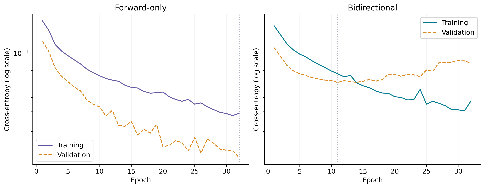
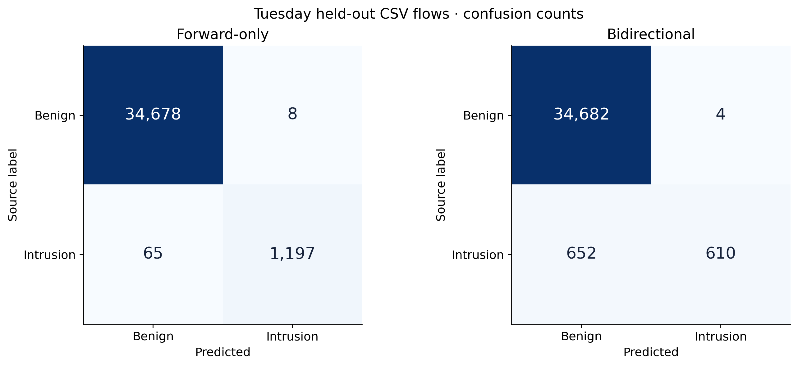
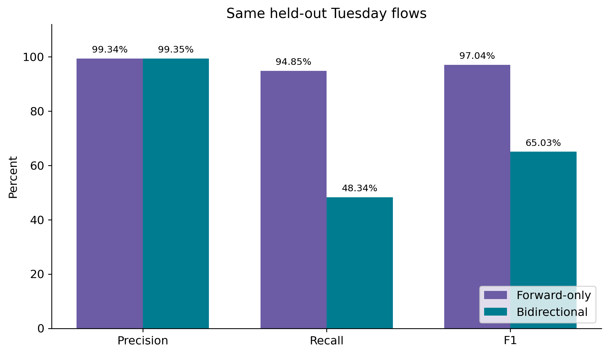
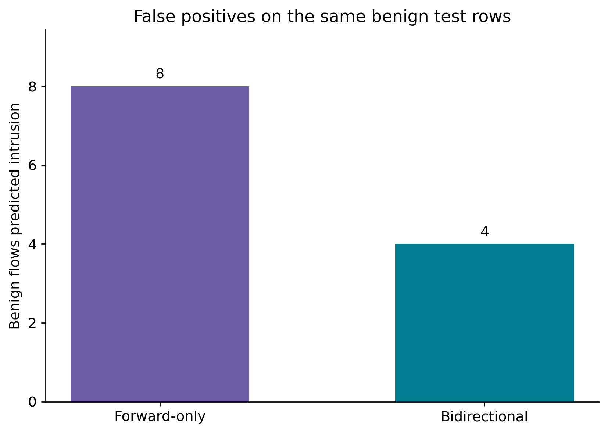

# Forward-only vs bidirectional six-input MLP on CIC-IDS-2017 Tuesday

9 November 2026 · **Completed offline CICFlowMeter CSV experiment**.
All results below are host FP32 classification on stored labeled CSV flows.
No model was quantized, loaded into eBPF, deployed, or tested on live traffic.

The bidirectional model's test F1 **decreased** relative to the forward control:
**97.0409% → 65.0320%**, a **-32.0090
percentage-point** difference in this fixed split/training run.
False positives changed from **8 to 4** (-4); benign test support is 34,686.

## Dataset and audit

Read only `/mnt/c/Study Materials/Semester 7/USAP/Term Project/GeneratedLabelledFlows.zip::TrafficLabelling /Tuesday-WorkingHours.pcap_ISCX.csv`. No download or PCAP join
was needed. Source-member SHA256: `ae9c88e10c41a8eb1ff454ae98bc513454925097d0b0b57180f94e79de445815`; archive SHA256:
`7bdbef286f8893f31c6db12105fa097fa5c2dcc6733179037a08129d150ea27a`. The streamed CSV contains 445,909 physical
data records and 85 columns, after trimming header whitespace.
Protocol counts: `{'6': 245781, '0': 316, '17': 199812}`. Original labels: `{'BENIGN': 432074, 'FTP-Patator': 7938, 'SSH-Patator': 5897}`.
The whole-source re-audit found **4**
complete duplicate rows, all TCP, and 211,628 distinct
Flow ID strings (234,281 repeated-ID excess).
Repeated IDs alone are not treated as duplicate records: reverse/timeout/FIN
appendices can share an ID. Every timestamp is minute-quantized on 4 July 2017,
without AM/PM or timezone. Original download provenance was operator-supplied,
not independently authenticated; hashes bind the actual analyzed files.
The [official UNB dataset description](https://www.unb.ca/cic/datasets/ids-2017.html)
and the existing dataset audit document the capture context. No release or
corrected label set was silently substituted.

The exact eligible population is **244,610 TCP rows**:
**230,775 BENIGN** and **13,835 intrusion**,
with source categories `{'BENIGN': 230775, 'FTP-Patator': 7938, 'SSH-Patator': 5897}`. These are source annotations,
not independent confirmation that every labeled attack succeeded. No balancing,
oversampling, class weighting or attack-category removal was performed.

| First exclusion reason (deterministic rule order) | Rows |
| --- | ---: |
| INVALID_DIRECTIONAL_IAT | 1,149 |
| NON_TCP | 200,128 |
| NEGATIVE_SELECTED | 17 |
| DUPLICATE_COMPLETE_TCP_ROW | 4 |
| INVALID_TCP_HEADER_TOTAL | 1 |

Every excluded source row has its member-hash/physical-line identity, label,
protocol and reason in `research/cic_csv_mlp/run/excluded.jsonl.gz`. Counts reconcile exactly
to the full input denominator. Additional anomalies in all columns are recorded
even when the first exclusion reason already applies. Only complete identical
TCP source rows are deduplicated; feature-equal rows and conflicting labels
are retained and grouped. The diagnostic from the previous PCAP study is not
merged into this dataset.

Selected numeric fields must be finite, integral, nonnegative int64. Require
at least one forward packet, valid ports, payload extrema in 0..65535, TCP-header
totals in 20..60 bytes per observed packet, directional IAT no greater than
flow duration, and zero IAT for fewer than two directional packets. Aggregate
features must fit int64 and the exact float64 integer range. No imputation or
clipping is applied. IPv4 identity and 4 July 2017 minute timestamps are checked.
The two named `Fwd Header Length` columns must agree. These are declared CSV
sanity rules, not a claim that CIC counts exactly reproduce kernel packets.

All column names, positions, observed numeric ranges/types, missing, NaN,
infinity, negative and malformed-numeric counts are in
`research/cic_csv_mlp/run/dataset_audit.json`. Anomalous columns (positions are zero-based):

| Column [position] | Missing | NaN | Infinity | Negative | Non-numeric |
| --- | ---: | ---: | ---: | ---: | ---: |
| Flow Duration [7] | 0 | 0 | 0 | 17 | 0 |
| Flow Bytes/s [20] | 0 | 201 | 63 | 0 | 0 |
| Flow Packets/s [21] | 0 | 0 | 264 | 17 | 0 |
| Flow IAT Mean [22] | 0 | 0 | 0 | 17 | 0 |
| Flow IAT Max [24] | 0 | 0 | 0 | 17 | 0 |
| Flow IAT Min [25] | 0 | 0 | 0 | 505 | 0 |
| Fwd Header Length [40] | 0 | 0 | 0 | 11 | 0 |
| Bwd Header Length [41] | 0 | 0 | 0 | 5 | 0 |
| Fwd Header Length [61] | 0 | 0 | 0 | 11 | 0 |
| Init_Win_bytes_forward [72] | 0 | 0 | 0 | 200128 | 0 |
| Init_Win_bytes_backward [73] | 0 | 0 | 0 | 256599 | 0 |
| min_seg_size_forward [75] | 0 | 0 | 0 | 11 | 0 |

Unused rate-column NaN/infinity does not enter either model and is not a reason
to drop an otherwise eligible row. Cleaning is stricter than the earlier
selected-column-only inventory; any changed row count is explained by the
explicit exclusions above, without consulting predictions.

## Exact feature definitions

Both representations use the same retained source rows, original CSV orientation
and source IAT **microseconds**. Packet lengths follow CICFlowMeter payload
conventions; TCP/IP/Ethernet headers are not added to those length columns.

| Input | Forward-only A | Bidirectional B |
| --- | --- | --- |
| 0 | Fwd Packet Length Max | Max of forward and observed backward maxima |
| 1 | Fwd IAT Max | Max of separate forward/backward IAT maxima; not Flow IAT Max |
| 2 | Fwd Packet Length Min | Min of observed-direction minima; measured zero is valid |
| 3 | Destination Port | Same original CSV destination port |
| 4 | Fwd Header Length | Forward + observed backward header totals |
| 5 | Total Fwd Packets | Total Fwd + Total Backward Packets |

For the **55,638** rows without backward packets, all
backward contributions are omitted. Nonzero unused backward fields occurred
in 0 retained rows and are diagnosed, not used.
No IPs, timestamps, flow IDs, labels or source-row indices enter the neural
inputs. Those identifiers are used only for grouping and audit.

| Representation / feature | Min | Max | Mean | Population SD |
| --- | ---: | ---: | ---: | ---: |
| forward / max_packet_length | 0 | 24,820 | 277.3 | 615.84 |
| forward / max_directional_iat_us | 0 | 119,000,000 | 4.4457e+06 | 1.1691e+07 |
| forward / min_packet_length | 0 | 2,065 | 0.63479 | 19.357 |
| forward / destination_port | 21 | 65,505 | 16078 | 24031 |
| forward / header_total | 20 | 4,225,596 | 471.97 | 24321 |
| forward / packet_count | 1 | 206,446 | 19.678 | 1170.6 |
| bidirectional / max_packet_length | 0 | 24,820 | 751.17 | 1199.4 |
| bidirectional / max_directional_iat_us | 0 | 119,000,000 | 4.6161e+06 | 1.1764e+07 |
| bidirectional / min_packet_length | 0 | 528 | 0.15494 | 2.8143 |
| bidirectional / destination_port | 21 | 65,505 | 16078 | 24031 |
| bidirectional / header_total | 40 | 9,747,036 | 1027.8 | 55981 |
| bidirectional / packet_count | 2 | 482,518 | 43.576 | 2752.8 |

## Frozen split and leakage limits

Shared train/validation/test split SHA256: `fc70a08f076b6e85f2887861785d5c30e0791f76433af7e18fb7e9f9f309fb72`.
Seed **20261109**. The protocol and three allowed grouping alternatives were
written before preparing the cohort or fitting either model. The first feasible
scheme was **1**: If first scheme cannot achieve each target within 5 percentage points with each source category represented, omit endpoint/minute unions; retain exact vectors and canonical tuples. See `split_attempts.json`
for every attempted component size and support count. Feasibility requires all
three source categories in every partition and row fractions within five
percentage points of 70/15/15. Selection does not use predictions.

| Partition | Rows | Benign | Intrusion | FTP-Patator | SSH-Patator | Union groups |
| --- | ---: | ---: | ---: | ---: | ---: | ---: |
| train | 172,715 | 161,402 | 11,313 | 5,537 | 5,776 | 28,268 |
| validation | 35,947 | 34,687 | 1,260 | 1,200 | 60 | 10,807 |
| test | 35,948 | 34,686 | 1,262 | 1,201 | 61 | 10,806 |

There are 49,881 union components; the largest has
114,120 rows. Exact six-vector repetitions are grouped for **both**
representations, including transitive links and conflicting-label vectors.
Overlap of source rows, union components and exact A/B vectors across partitions
is **zero**. Repetition diagnostics: `{'forward': {'unique_vectors': 184260, 'duplicate_excess': 60350, 'conflicting_label_vectors': 2, 'rows_in_conflicting_vectors': 3580}, 'bidirectional': {'unique_vectors': 182108, 'duplicate_excess': 62502, 'conflicting_label_vectors': 1, 'rows_in_conflicting_vectors': 3372}}`. The complete source-ID,
row-index, group and partition mapping is saved in `split_rows.csv.gz` and
numeric `split.npz`; both models use exactly those IDs.

**This is not campaign-independent testing.** Tuesday has only FTP/SSH campaigns,
so the earlier three-campaign requirement was explicitly relaxed for this new
CSV-only task. Time is minute-quantized without AM/PM or offset; proxies are not
validated independent sessions. Related attack activity, hosts, ports and
near-duplicate behavior can still correlate across partitions. Grouping is
stronger than an unqualified random-row split, but does not establish new-day,
new-host, new-attack or external generalization.

Group preservation also changes class prevalence between partitions: the
training/validation/test category counts above are not perfectly stratified.
Only 61 SSH-Patator rows
remain in test, so its subgroup estimate is especially narrow. The large
component and failed stronger scheme are reported instead of silently breaking
duplicate/session groups to improve balance or scores.

## Training and checkpoint identity

Both models instantiate the authors' `src/mlp.py` **Net(6,2)** from scratch:
bias-free **6→32→32→2**, ReLU hidden layers, exactly **1,280 weights**. Same seed,
same initial weight hash, same shuffled training IDs, Adam defaults with
lr=0.001, unweighted cross-entropy, batch size 512, **32 epochs**, CPU, one Torch
thread and deterministic algorithms. No prior model/checkpoint is loaded.

Each representation has a separate StandardScaler fitted on training IDs only.
Scaling is float64 `(x-mean)/scale`, then float32 input. Validation/test never
fit scaler statistics. Independent training-mean/variance recalculations passed.
The minimum validation cross-entropy selects each checkpoint; earliest exact
ties win. Test outputs were computed only after both checkpoints were frozen.
Argmax over two logits is unchanged; exact FP32 ties select class 0.

| Model | Best epoch | Validation CE | Checkpoint SHA256 | Numeric scaler SHA256 |
| --- | ---: | ---: | --- | --- |
| forward | 32 | 0.011703516 | `8e223146dee0bfda439da2a1d5b756aefebf517785e4f803994d08e540f2ed41` | `2adc2afbabb23c4157baa269f305f6c66a14ed3c63a08bd117b53cb6b290ac2d` |
| bidirectional | 11 | 0.054601870 | `1fdbe972e4eb8d68f44b4c553348f891989bcc970c950ab6e27639a597f6ab91` | `024856617c03610875d074c3d719be8615e87cf7ffe80064b746942a2e95aa7b` |

Numeric-only NPZ checkpoints/scalers use `allow_pickle=False`. Reloaded
validation and test logits match saved outputs **bit for bit**. Epoch train/val
losses, normalized ranges, checkpoint-selection evidence, initialization,
dataset/split hashes and environment are saved beside each checkpoint.



## Held-out results

Positive class = intrusion. Confusion order is **[[TN, FP], [FN, TP]]**.
Both models classify the same **35,948** test rows with **100% coverage**,
zero rejected/missing predictions, finite normalized inputs and finite logits.
The test support is **34,686 benign / 1,262 intrusion**.

| Metric | Forward-only A | Bidirectional B | B − A |
| --- | ---: | ---: | ---: |
| Accuracy | 99.7969% | 98.1751% | -1.6218 pp |
| Precision | 99.3361% | 99.3485% | +0.0124 pp |
| Recall | 94.8494% | 48.3360% | -46.5135 pp |
| F1 | 97.0409% | 65.0320% | -32.0090 pp |
| TP | 1197 | 610 | -587 |
| FP | 8 | 4 | -4 |
| TN | 34678 | 34682 | +4 |
| FN | 65 | 652 | +587 |
| Specificity | 99.9769% | 99.9885% | +0.0115 pp |
| False-positive rate | 0.0231% | 0.0115% | -0.0115 pp |
| Balanced accuracy | 97.4132% | 74.1622% | -23.2510 pp |
| MCC | 0.969636 | 0.686425 | -0.283211 |
| Average precision (step PR-AUC) | 98.2828% | 97.7598% | -0.5230 pp |
| Trapezoidal PR-AUC | 98.2787% | 97.7360% | -0.5427 pp |

Forward confusion: **[[34678, 8], [65, 1197]]**. Bidirectional confusion:
**[[34682, 4], [652, 610]]**. All counts independently reconcile to the same
test denominator. Manual confusion formulas and tied-score PR calculations
agree with scikit-learn. Average precision is step-integrated PR-AUC;
trapezoidal PR-AUC is separately named. Both rank by logit1−logit0, without
test-fitted thresholds.





| Attack source category | Test support | Forward recall | Bidirectional recall |
| --- | ---: | ---: | ---: |
| FTP-Patator | 1,201 | 97.2523% | 48.5429% |
| SSH-Patator | 61 | 47.5410% | 44.2623% |

Per-port results (including 21/22 and other ports with at least 100 test rows)
and benign false-positive rates are retained in `evaluation/metrics.json`.
No subgroup result was used to tune or retrain a model.

## Paired comparison, baselines and interpretation

Predictions disagree on **599** test rows. B corrects
**8** A errors and makes **591** A-correct
rows incorrect. Class-wise counts: `{'0': {'support': 34686, 'changed': 12, 'corrected': 8, 'made_incorrect': 4}, '1': {'support': 1262, 'changed': 587, 'corrected': 0, 'made_incorrect': 587}}`.

Paired percentile bootstrap: 2,000 draws of whole frozen test union components,
same sampled components for both models, seed 20261110. The 95% interval for
F1(B)−F1(A) is **[-32.7806, -30.3806] percentage points**.
This interval is conditional on the fixed trained models and imperfect proxy
groups. Residual campaign dependence and training-seed variability are not
captured; it is not a campaign-level significance or generalization claim.

Training-majority baseline class = 0:
accuracy **96.4894%**, F1
**0.0000%**. A training-only destination-port lookup
achieves accuracy **99.8859%**, F1
**98.4016%**, FP
**41**, FN
**0**. It learns the majority source
label per training port, with class-0 ties and training-majority fallback for
unseen ports. This diagnostic measures how much service-port correlation alone
can explain; it does not establish what either MLP internally relies on.

The port-only lookup has higher F1 than either MLP in this split, which is a
strong warning about service-port shortcuts in Tuesday's source labels.
The bidirectional model's average precision remains
0.977598 despite its lower recall at the fixed argmax
decision. Ranking quality and the chosen operating point are different
measurements; no test-derived threshold adjustment was made.

Aggregating max/min/sums also loses directional identity. This result does
not show that all uses of bidirectional information are harmful, or isolate
which aggregate caused the decrease. It establishes the measured trade-off for
these two representations, fixed architecture, budget and split. A future
multi-seed or alternative-representation study needs its own declared protocol;
this test set was not used to redesign the features or training.

These results describe one naturally imbalanced, cleaned Tuesday population,
one frozen split and one paired initialization/training seed. Source labels and
CICFlowMeter flow construction have known limitations. High F1 can reflect
service ports or capture conditions rather than attack behavior. No improvement
over the separately evaluated reproduction model, paper benchmark, deployed
extractor, kernel arithmetic or live IDS is inferred.

## Validation, reproduction and files

Saved-record/model/scaler/split audit: **PASS**. Host tests:
`{'status': 'PASS', 'host_tests': 19, 'command': ['/tmp/nn-ebpf-cic-bidir-20261109/bin/python', '-B', '-m', 'unittest', '-v', 'research.cic_csv_mlp.test_study'], 'kernel_tests': 'NOT RUN', 'live_network_tests': 'NOT RUN'}`. The audit rereads every saved prediction CSV row, checks
identities/features/logits/labels against numeric archives, reexecutes both
checkpoints, verifies scaler fits and selected validation epochs, and checks
all freeze hashes. Production preservation: 5,067
existing main-checkout file hashes and 25
prior-study files remain unchanged. No kernel, namespace or physical-network
operation was run in this task.

Environment: Python 3.10.12, `{'numpy': '2.2.6', 'torch': '2.5.1+cpu', 'sklearn': '1.7.2', 'matplotlib': '3.10.3'}`, kernel
`6.6.87.2-microsoft-standard-WSL2`, x86_64. Base Git commit `711b909261e352cfb87ce3c34d598f5615e04661`;
branch `feature/bidirectional-mlp`. Work is uncommitted; no commit or push was performed.
Pinned package list is saved in `requirements.txt`. Existing temporary packages
were unavailable, so dependencies were installed only in a new `/tmp` venv.

From this isolated worktree root, actual stages were run in order:

```bash
PY=/tmp/nn-ebpf-cic-bidir-20261109/bin/python
export PYTHONDONTWRITEBYTECODE=1
export MPLCONFIGDIR=/tmp/nn-ebpf-cic-bidir-mpl

"$PY" -B -m unittest -v research.cic_csv_mlp.test_study

# For reproduction choose a NEW output directory; frozen outputs refuse overwrite.
OUT=research/cic_csv_mlp/run-reproduction
"$PY" -B -m research.cic_csv_mlp.pipeline prepare --output "$OUT" \
  --source '/mnt/c/Study Materials/Semester 7/USAP/Term Project/GeneratedLabelledFlows.zip'
"$PY" -B -m research.cic_csv_mlp.forensics --output "$OUT" \
  --source '/mnt/c/Study Materials/Semester 7/USAP/Term Project/GeneratedLabelledFlows.zip'
"$PY" -B -m research.cic_csv_mlp.pipeline split --output "$OUT"
"$PY" -B -m research.cic_csv_mlp.pipeline train --output "$OUT"
"$PY" -B -m research.cic_csv_mlp.pipeline evaluate --output "$OUT"
"$PY" -B -m research.cic_csv_mlp.pipeline audit --output "$OUT"
"$PY" -B -m research.cic_csv_mlp.pipeline report --output "$OUT"

# Screenshot-friendly summary of the existing completed run; does not retrain:
"$PY" -B -m research.cic_csv_mlp.pipeline summary --output research/cic_csv_mlp/run
```

The measured run used `OUT=research/cic_csv_mlp/run`. The previous PCAP study and all its
evidence remain unchanged. New code is exclusively under `research/cic_csv_mlp/`:
protocol, dataset/feature audit, union split, trainer, metric/evaluation code,
saved-result auditor/report/plots, CLI, tests and README. This report is the only
new root document. Numeric data/checkpoints/raw predictions are under ignored
`research/cic_csv_mlp/run/`; no large archive, raw CSV or executable is added to Git.
Suggested review boundaries: (1) protocol/data/split and tests; (2) training,
evaluation, audit/report and small summary/figures. Stage explicit paths after
review; do not use `git add .`, merge the demo branch or commit large run archives.

## What remains before TC integration

The model is **not deployable as-is**. CIC payload extrema differ from kernel
TCP-segment extrema, timestamps use microseconds rather than helper ns, CSV
forward direction can differ from monitored ingress, and completed CSV windows
can contain packets arriving after the demo's first-ingress-FIN decision.
Unit conversion alone does not repair direction/window or length conventions.

A separate integration study must either collect faithfully labeled kernel-
equivalent bidirectional training windows or deliberately implement and verify
compatible feature semantics. Current egress state lacks segment min/max,
directional maximum IAT and TCP-header totals. Add separate versioned
experimental state and consistent locked snapshots; specify termination and
bounded expiration, tuple reuse, duplicate prevention and per-CPU ownership.
Fit a compatible training-only scaler and separate model parameters, quantize
to Q16 with range/overflow checks, verify loaded map bytes, all six stages,
intermediate tensors/logits and reference predictions. Run verifier/concurrency
and one/ten/32/asymmetric/missing-direction namespace tests. Hold ingress fixed,
vary egress, and prove the actual MLP input changes. Only subsequent operator-
controlled live testing can measure live detection performance. No production
model/default or working demonstration was modified here.

## Direct answers

- **Q1:** 244,610 eligible TCP rows; train
  172,715, validation 35,947,
  test 35,948, shared by both models.
- **Q2:** Forward: F1 97.0409%, precision 99.3361%, recall
  94.8494%, accuracy 99.7969%; matrix [[34678, 8], [65, 1197]].
- **Q3:** Bidirectional: F1 65.0320%, precision 99.3485%, recall
  48.3360%, accuracy 98.1751%; matrix [[34682, 4], [652, 610]].
- **Q4:** F1 decreased; B−A = -32.0090 pp.
- **Q5:** False positives changed from **8 to 4** (-4); benign test support is 34,686.
- **Q6:** Within-Tuesday proxy-group evaluation, source-label/capture correlation,
  port shortcuts, one training seed and no new-day/campaign independence.
- **Q7:** Compatible kernel training windows/features, missing egress state and
  trigger/lifecycle design, new scaler/quantization, map/tensor/kernel/network
  validation, then separately measured live effectiveness remain outstanding.
