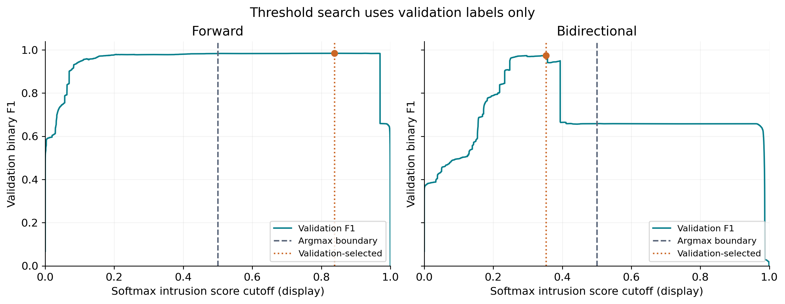
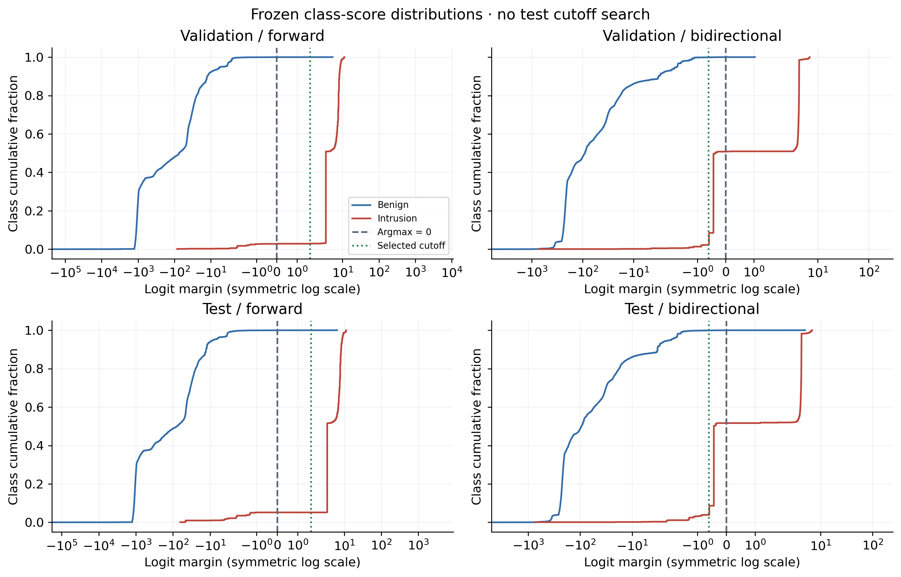

# Validation-threshold sensitivity: frozen CICFlowMeter MLPs

9 November 2026. **Separate, post-hoc analysis; the original argmax comparison
is preserved unchanged.** This is offline analysis of saved FP32 logits.
No model, scaler, split, test record, eBPF program or live demonstration changed.

## Main finding

Bidirectional recall changes from **48.3360% to 96.1173%**;
F1 changes from **65.0320% to 96.6919%**, or
**+31.6599 percentage points**.
Changing only the cutoff recovers **603 / 652** (92.48%) original bidirectional false negatives. It introduces 30 additional false positives and loses 0 original true positives.

The default decision boundary explains most of the original low recall on this cohort: most missed positives are recoverable without changing weights or ranking.
This identifies an operating-point effect, not why training placed the boundary
there, nor proof that all remaining errors have the same cause.

The fair comparison also tunes the forward model by the same validation-only
objective: its F1 becomes **97.2380%**, versus **96.6919%** for
bidirectional. Thus B−A is **-0.5461 percentage points** after both cutoffs
are selected. The conditional group-bootstrap 95% interval is
**[-2.0600, +0.8071] pp**. These exact values, together with
the precision/recall trade-off below, define how competitive the two models are
on this reused cohort; they do not establish campaign-level generalization.
This conditional interval includes zero; it does not resolve a clear F1 advantage.
Compared with its original operating point, B is much more competitive, but
its adjusted test precision is **97.2735%** versus
**99.7500%** for A, and false positives are **34 versus
3**. Its recall is **96.1173%** versus **94.8494%**.
The smaller F1 gap is not evidence of bidirectional superiority.

## Predeclared validation-only objective and tie handling

Use margin **m = float64(logit1) − float64(logit0)** from saved FP32 logits.
The original argmax predicts intrusion iff **m > 0**; equal logits select benign.
The new rule predicts intrusion iff **m >= t**. For each model separately,
maximize ordinary binary intrusion **validation F1 = 2TP/(2TP+FP+FN)**.

Candidate cutoffs are every distinct validation margin, moving all equal-score
rows together, plus a finite cutoff just above the maximum (all-negative rule).
Compare F1 ratios using integer cross-products. On exact F1 ties prefer fewer
FP, then the largest cutoff. No subgroup-specific cutoffs, class balancing,
test-score candidates or test-label optimization are used. Sigmoid(m) is shown
as a softmax-score cutoff for interpretation only; scores are not claimed to
be calibrated attack probabilities. Optimization and application use margins
to avoid softmax saturation or rounding changing tied-score groups.
Argmax remains the valid original decision rule; changing the operating
criterion is not an arithmetic bug fix or a fitted probability calibrator.

Selection reads **35,947 validation labels**:
34,687 benign and 1,260
intrusion. Original checkpoint selection already used this validation set;
threshold selection adds another validation-dependent decision.
Both thresholds, their hexadecimal float64 representations, protocol, source
preservation hashes, full validation curves and decisions were frozen in
`THRESHOLDS_FROZEN.json` before test predictions were parsed. Its SHA256 is
`7edd598b6c2c9f522a50b8d1cae4f733156d781489184e4d9007868357b95b82`.

| Model | Margin cutoff t | Softmax cutoff (display) | Validation argmax F1 | Selected precision | Selected recall | Selected F1 | TP/FP/TN/FN |
| --- | --- | ---: | ---: | ---: | ---: | ---: | --- |
| forward | `1.645606517791748` | 0.838296374 | 98.3541% | 99.7555% | 97.1429% | 98.4318% | 1224/3/34684/36 |
| bidirectional | `-0.60577148199081421` | 0.353024382 | 65.8874% | 96.9315% | 97.7778% | 97.3528% | 1232/39/34648/28 |



## Frozen test application

Apply the stored cutoffs once to the same **35,948** saved test
rows: 34,686 benign / 1,262 intrusion.
An exclusive application marker prevents a second evaluation in this output
directory. No neural inference was reexecuted. Original argmax decisions and
metrics match the earlier frozen records exactly. Both rules have 100% coverage;
all saved margins are finite. Auditing the resulting saved decisions does not
constitute a new cutoff search or operating-point evaluation.

| Model | Rule | Precision | Recall | F1 | TP | FP | TN | FN |
| --- | --- | ---: | ---: | ---: | ---: | ---: | ---: | ---: |
| forward | Original argmax | 99.3361% | 94.8494% | 97.0409% | 1197 | 8 | 34678 | 65 |
| forward | Validation F1 cutoff | 99.7500% | 94.8494% | 97.2380% | 1197 | 3 | 34683 | 65 |
| bidirectional | Original argmax | 99.3485% | 48.3360% | 65.0320% | 610 | 4 | 34682 | 652 |
| bidirectional | Validation F1 cutoff | 97.2735% | 96.1173% | 96.6919% | 1213 | 34 | 34652 | 49 |

The original matrices and results remain in the original experiment. Every new
decision is separately exported to `test_decisions.csv.gz` and numeric NPZ,
including stable source-member/line IDs, class, group, margin and both decisions.
All metrics can be recomputed from those records. No row is omitted or relabeled.

| Attack | A support | A argmax recall | A selected recall | B support | B argmax recall | B selected recall |
| --- | ---: | ---: | ---: | ---: | ---: | ---: |
| FTP-Patator | 1201 | 97.2523% | 97.2523% | 1201 | 48.5429% | 98.1682% |
| SSH-Patator | 61 | 47.5410% | 47.5410% | 61 | 44.2623% | 55.7377% |

## Score separation and boundary position

Threshold changes leave every logit, score ordering, ROC-AUC and average precision
unchanged. A high ranking score can coexist with poor recall at a zero-margin
decision. The following quantiles show whether intrusion scores lie below that
boundary despite being separated from many benign scores. Complete min/max,
mean, SD, 1/5/25/50/75/95/99 percentiles and boundary counts are saved in JSON.

| Phase | Model | Class | Count | Margin p5 | Margin median | Margin p95 | Softmax median |
| --- | --- | --- | ---: | ---: | ---: | ---: | ---: |
| Validation | forward | Benign | 34687 | -1165.28 | -73.7533 | -5.00085 | 9.31842e-33 |
| Validation | forward | Intrusion | 1260 | 3.47859 | 3.48145 | 8.66213 | 0.970155 |
| Test | forward | Benign | 34686 | -1163.26 | -78.0376 | -7.98094 | 1.28442e-34 |
| Test | forward | Intrusion | 1262 | -1.05668 | 3.48144 | 8.7732 | 0.970155 |
| Validation | bidirectional | Benign | 34687 | -255.449 | -90.0832 | -1.70836 | 7.53953e-40 |
| Validation | bidirectional | Intrusion | 1260 | -0.588203 | -0.361745 | 4.31 | 0.410537 |
| Test | bidirectional | Benign | 34686 | -254.542 | -94.2983 | -1.90257 | 1.11374e-41 |
| Test | bidirectional | Intrusion | 1262 | -0.588214 | -0.430695 | 4.31025 | 0.39396 |

| Phase | Model | ROC-AUC | Average precision |
| --- | --- | ---: | ---: |
| Validation | forward | 0.99868463 | 0.99464000 |
| Test | forward | 0.99534522 | 0.98282820 |
| Validation | bidirectional | 0.99824746 | 0.98431184 |
| Test | bidirectional | 0.99802194 | 0.97759845 |



Plots retain the complete margin range using a symmetric-log x-axis. Test
distributions are descriptive after the cutoffs are fixed. **There is no test
F1-versus-threshold sweep.** Score separation is not independent validation of
the source labels or evidence of live-network detection effectiveness.

## Limitations and interpretation

- This study was requested **after the original test results were known**.
  Cutoffs use validation labels only, but the test set is being reused for a
  post-hoc question. It is not a new confirmatory or independently untouched test.
- Both thresholds optimize the particular validation prevalence and F1 cost
  trade-off. Recall improvements can increase false positives; another traffic
  prevalence or operating cost need not favor these cutoffs.
- The same within-Tuesday split limitations apply: correlated campaigns, service-
  port shortcuts, proxy grouping, a large training component, only 60 validation
  and 61 test SSH-Patator rows, and one training seed. The original port-only
  baseline remains relevant.
- The optional interval resamples whole original test union-components, with
  paired draws for both selected-threshold models (2,000 draws, seed 20261111).
  It is conditional on fixed fitted models/cutoffs; residual campaign correlation,
  training variance and validation-threshold selection uncertainty are not
  captured. It is not an attack-campaign-independent significance claim.
- This does not establish that aggregating egress features improves the deployed
  model. CICFlowMeter feature/window semantics still differ from the kernel.
  No threshold was installed in the live IDS, and the original comparison is
  not replaced by the more favorable operating point.

## Reproducibility and preservation

Artifacts are under `research/cic_threshold_sensitivity/run/`. `thresholds.json` records validation outcomes
and exact cutoffs; `results.json` records both original and adjusted test metrics,
score summaries and category counts. Saved decisions, curves, source hashes,
threshold/result freezes and `audit.json` provide the evidence chain.
The selection process is separate from test application; its input list and
`test_arrays_parsed: false` are saved. Tests include a guard that fails if the
selector attempts to parse any test archive, exact-rational brute-force checks,
equal-score blocks, equality rules, nonfinite input rejection and the one-time
application marker. No optimizer, checkpoint loader or training routine is used.

From the existing `feature/bidirectional-mlp` worktree:

```bash
PY=/tmp/nn-ebpf-cic-bidir-20261109/bin/python
export PYTHONDONTWRITEBYTECODE=1
export MPLCONFIGDIR=/tmp/nn-ebpf-cic-bidir-mpl
"$PY" -B -m unittest -v research.cic_threshold_sensitivity.test_sensitivity

# Use a NEW directory for a deliberate reproduction; do not rerun evaluate
# in the completed measured directory.
OUT=research/cic_threshold_sensitivity/run-reproduction
"$PY" -B -m research.cic_threshold_sensitivity.study select \
  --source research/cic_csv_mlp/run --output "$OUT"
"$PY" -B -m research.cic_threshold_sensitivity.study evaluate --output "$OUT"
"$PY" -B -m research.cic_threshold_sensitivity.study audit --output "$OUT"
"$PY" -B -m research.cic_threshold_sensitivity.study report --output "$OUT"
```

The measured run used `OUT=research/cic_threshold_sensitivity/run`. Audit/report commands read saved decisions
and may be rerun without applying thresholds again. The existing experiment's
dependency versions are reused; no new package or dataset download was required.
New files are confined to `research/cic_threshold_sensitivity/` and this report.
Original sources, weights, scalers, split, predictions, reports and live demo
remain unchanged. No Git commit or push was performed.
