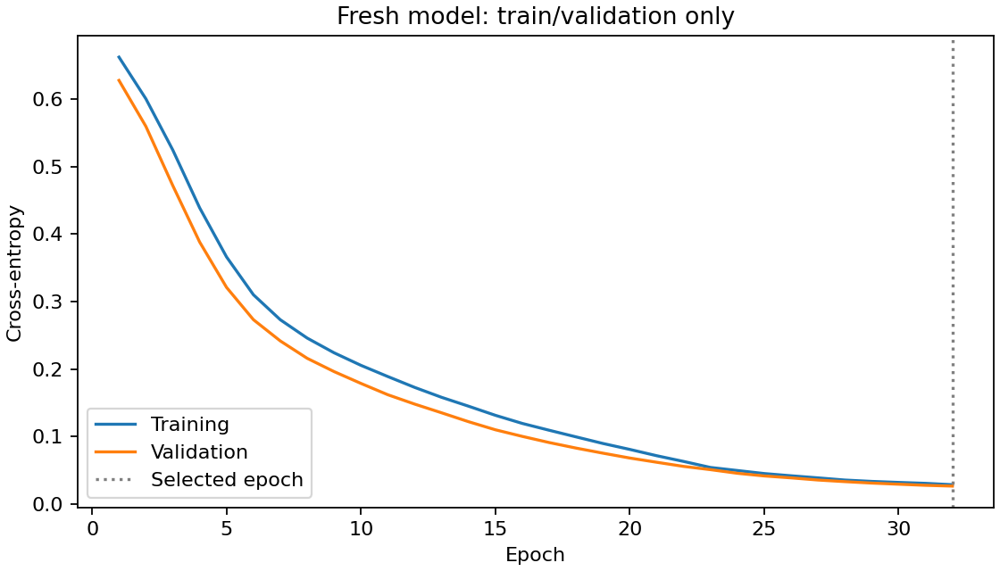
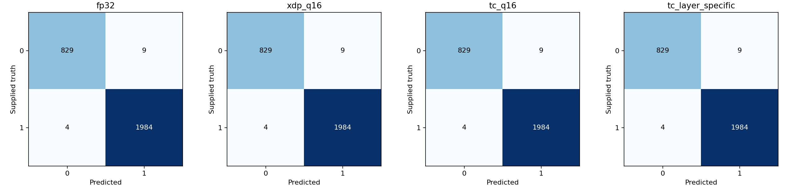
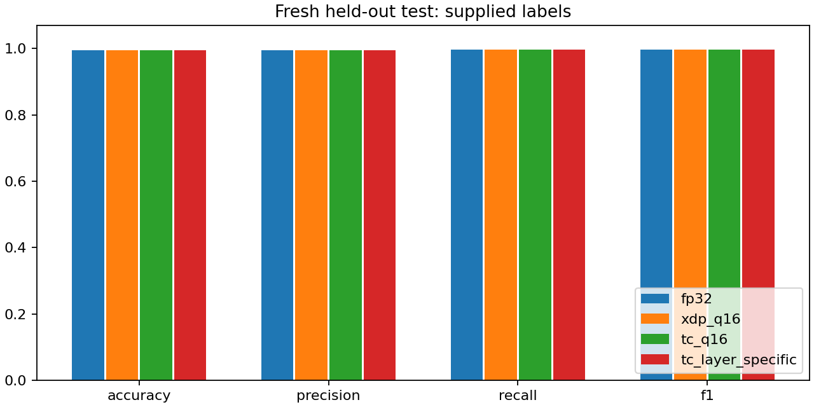
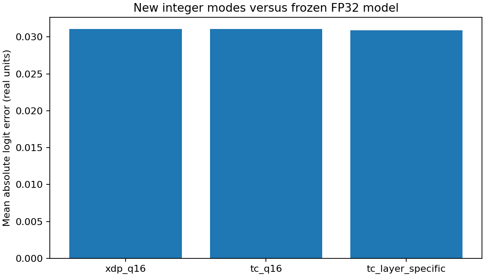

# Fresh experimental NN-eBPF model — held-out evaluation

**Fresh-model held-out evaluation and full TC kernel benchmark: PASS.** This is a newly initialized model, separate
from the deployed checkpoint. The previous model, scaler, calibration, source,
dashboard and original latency experiment remain unchanged. No physical deployment
or network configuration change occurred.

## Dataset and leakage controls

Authors' numeric eBPF-Reproduction arrays: 18,840 rows; 18,561 distinct complete
six-feature vectors; 279 duplicate excess rows. Supplied codes: 0=benign,
1=intrusion. Collection labels are used as given; no trusted capture-day/session
metadata or independently audited attack identities accompany these arrays.

| Partition | Rows | Benign (0) | Intrusion (1) |
| --- | ---: | ---: | ---: |
| train | 13187 | 3909 | 9278 |
| validation | 2827 | 838 | 1989 |
| test | 2826 | 838 | 1988 |

Seed **20261108**. Exact duplicate vectors are grouped, shuffled separately within
each label, then assigned at nearest cumulative 70%/85% row boundaries. Every row
occurs once; no feature group crosses a partition. This is a group-separated
random within-dataset split, not a held-out capture-day experiment. Seed/split
were frozen before training or observing predictions. The scaler fits training
rows only. Test rows do not select the checkpoint or quantization scales.

[Split manifest](experiments/fresh_model_20261108/run/split.json), [split gate](experiments/fresh_model_20261108/run/gate1.json),
[training-only scaler](experiments/fresh_model_20261108/run/scaler.json), [frozen configuration](experiments/fresh_model_20261108/run/config.json).
Dataset SHA256: features `787a3bf845a5714f79c27aafceaa6feeb59ec53a405035d2ebe64775a3dcb96e`;
labels `edbbc05ed553442139c0ddd7b8211aa8aa98347c7b8d3d2e3e7a0f72463d1924`.

## Training and checkpoint

Reuses the authors' `Net` class: bias-free 6→32→32→2, ReLU after each hidden
linear layer, 1,280 parameters, two logits and cross-entropy. CPU Adam, learning
rate 0.001, batch size 512, 32 epochs; no hyperparameter search or test-based
tuning. One CPU thread and deterministic PyTorch algorithms; seed 20261108.
Selected epoch **32**, minimum validation cross-entropy
**0.026574340**, earliest exact tie. DataLoader workers=0
is a reproducibility adaptation of the original script. The original script's
full-dataset scaler fit is corrected only in this separate experiment.

Checkpoint is a numeric-only NPZ, loaded with `allow_pickle=False`; neither
untrusted pickle nor the authors' unrestricted `torch.load` path is executed.
All selected weights and FP32 test logits are finite.
Checkpoint SHA256: `d299f964ecaa7b918eca65529371dbfa6db8797df97ee24b73a324ab52acef1b`.
Scaler SHA256: `398d55164614ecc6c5307b27bada51fe435f81e4dd27cfddb1c2e3489ebd8fed`.
[Training history](experiments/fresh_model_20261108/run/history.json), [freeze gate](experiments/fresh_model_20261108/run/freeze.json).



## Untouched test results

Every prediction retains its original row ID, six raw values, normalized FP32
values, logits, supplied truth and checkpoint/scaler identifiers. Intrusion is
the positive class. Confusion matrices use `[[TN, FP], [FN, TP]]`. Independent
integer counts/formulas are cross-checked with scikit-learn; saved prediction
records reproduce the metrics. Missing/invalid predictions are abstentions,
never benign. Undefined metrics are null; eligible metrics are conditional on
valid predictions and coverage is reported separately.

| Measurement | FP32 host | XDP Q16 host C | TC Q16 host C | TC layer-specific host C |
| --- | ---: | ---: | ---: | ---: |
| TP | 1984 | 1984 | 1984 | 1984 |
| FP | 9 | 9 | 9 | 9 |
| TN | 829 | 829 | 829 | 829 |
| FN | 4 | 4 | 4 | 4 |
| accuracy | 0.995399858 | 0.995399858 | 0.995399858 | 0.995399858 |
| precision | 0.995484195 | 0.995484195 | 0.995484195 | 0.995484195 |
| recall | 0.997987928 | 0.997987928 | 0.997987928 | 0.997987928 |
| f1 | 0.996734489 | 0.996734489 | 0.996734489 | 0.996734489 |
| specificity | 0.989260143 | 0.989260143 | 0.989260143 | 0.989260143 |
| false_positive_rate | 0.010739857 | 0.010739857 | 0.010739857 | 0.010739857 |
| balanced_accuracy | 0.993624035 | 0.993624035 | 0.993624035 | 0.993624035 |
| mcc | 0.988963682 | 0.988963682 | 0.988963682 | 0.988963682 |
| macro_f1 | 0.994477358 | 0.994477358 | 0.994477358 | 0.994477358 |
| weighted_f1 | 0.995395865 | 0.995395865 | 0.995395865 | 0.995395865 |
| coverage | 1.000000000 | 1.000000000 | 1.000000000 | 1.000000000 |
| invalid_missing | 0 | 0 | 0 | 0 |

**FP32 accuracy 0.995399858; precision 0.995484195;
recall 0.997987928; F1 0.996734489.**
These measure the fresh model against supplied labels on rows excluded from our
training/scaler fit/checkpoint selection. They do not establish generalization
to independently captured days, external CIC traffic or live demo connections.




[FP32 prediction archive](experiments/fresh_model_20261108/run/fp32-predictions.jsonl.gz),
[FP32 exact metrics and per-class report](experiments/fresh_model_20261108/run/fp32-metrics.json).
FP32 retains authors' `argmax` tie→0; integer modes retain kernel tie→1. No
threshold or label mapping was chosen from test results.

## Integer conversion and numerical evidence

**Host conversion/comparison: PASS**, using the new weights and the same
2,826 test IDs. Actual original XDP arithmetic and TC stages are host-compiled
with existing mocks in an isolated copied source tree; this is not kernel
execution. Only copied model/calibration headers differ; deployed files stay
unchanged. Q16 uses nearest-even weight quantization, rounded int64 scaler,
unsigned-magnitude normalization, int64 products/accumulators, arithmetic >>16
flooring and original int32 narrowing. The independent reference checks
representability and flags unsafe rows before host C execution. No clipping or
saturation is added to the original implementation.

Layer-specific scale selection uses training rows only and the existing
conservative selector. Weights remain Q16 representations of this same fresh
FP32 checkpoint; layer-specific mode improves activation precision/rounding,
not weight precision. Unsupported inputs are retained as rejected records.
Every successful C stage is checked against its corresponding independent
Python integer reference. Stage errors versus FP32 use each layer's exponent;
weights/scaler quantization contribute to those errors. Exact-rational Q16
header-network errors are reported separately, rather than calling that model
identical to FP32.

- XDP Q16 ↔ TC Q16 tensor mismatches: **0**.
- FP32 ↔ Q16 prediction changes (both valid): **0**.
- Q16 ↔ layer-specific prediction changes (both valid): **0**.
- Common-valid test rows: **2826** of 2,826.

| Integer mode | Logit MAE vs FP32 | Max abs vs FP32 | MAE vs exact Q16 header | Max abs vs exact Q16 header |
| --- | ---: | ---: | ---: | ---: |
| xdp_q16 | 0.0311137427486 | 1.47592163086 | 0.000315718234992 | 0.000993705282849 |
| tc_q16 | 0.0311137427486 | 1.47592163086 | 0.000315718234992 | 0.000993705282849 |
| tc_layer_specific | 0.0308938887595 | 1.47631835938 | 4.08178084532e-06 | 1.70126698276e-05 |

Errors are in real logit units, over 5,652 test logits. The rounded scaler and
Q16 weights also differ from the FP32 model: layer-specific activation precision
does not recover those discarded values. Its lower mean error does not imply
lower maximum error or improved F1. No test example was removed based on error.
All modes had zero equal-logit ties in this cohort.

| Stage | Q16/layer-specific unequal values at common binary scale | Compared values |
| --- | ---: | ---: |
| normalized | 16924 | 16956 |
| linear0 | 89946 | 90432 |
| relu0 | 49430 | 90432 |
| linear1 | 88702 | 90432 |
| relu1 | 46528 | 90432 |
| logits | 5646 | 5652 |

These cross-scale differences are expected quantization/rounding differences,
not failures of the corresponding C/Python parity checks. Across all three
modes, every output matched its own integer reference: **50,868 stage tensors /
1,153,008 integers in total**.
The complete per-layer mean/max errors and both-mode rejection reasons are
in the machine-readable comparison. No overflow/narrowing/rejection occurred
on the training calibration rows or test cohort. The UBSan result is recorded
separately as host execution, with no kernel implication.

[Per-row integer predictions/tensors](experiments/fresh_model_20261108/run/integer-predictions.jsonl.gz),
[comparison, all metrics, errors, failures and common-valid subset](experiments/fresh_model_20261108/run/comparison.json),
[quantization/calibration gate](experiments/fresh_model_20261108/run/quantization.json).



## New-model full kernel benchmark — PASS

The operator separately approved and executed the full run after the audited
100-vector pilot. All **2,826 held-out test row IDs** were used in both TC modes,
with one complete warmup pass and **five measured trials**. No model, scaler,
calibration or classification rule was changed after observing test results.
Each mode has **14,130 measured durations** and 2,826 cohort warmups; repetitions
are not additional independent dataset samples.

| Actual fresh-model measurement | TC Q16 | TC layer-specific |
| --- | ---: | ---: |
| Mean (µs) | 2.261666 | 7.127888 |
| Median / p50 (µs) | 1.623000 | 5.536000 |
| p95 (µs) | 4.099000 | 13.490550 |
| p99 (µs) | 7.469560 | 23.271590 |
| Minimum (µs) | 1.344000 | 2.349000 |
| Maximum (µs) | 341.806000 | 367.532000 |
| Population SD (µs) | 5.393199 | 8.874349 |
| Measured calls | 14,130 | 14,130 |
| Kernel-time-normalized inferences/s | 442,151.930 | 140,294.015 |
| Failed calls / numerical mismatches | 0 / 0 | 0 / 0 |

Within this same-model/same-input experiment, layer-specific mean latency was
**3.151609× TC Q16**
(215.160936% higher); median latency
was 3.410967× TC Q16. This compares the
complete existing implementations, including their checks and telemetry.
It is not a measurement of pure matrix arithmetic, and lower numerical error
did not change F1 or any test classification.

The measurement is kernel-returned `BPF_PROG_TEST_RUN` duration, `repeat=1`, from
`tc_preprocessing` through six stages and five real tail-call transitions,
result publication and workspace release. It includes existing map lookups,
synchronization, diagnostics/telemetry and kernel test-run timing overhead.
Private flow/result/per-CPU workspace resets, userspace syscall/IPC wall time,
read-back, validation and I/O occur outside the measured duration. The synthetic
packet supplies context/key only; it does not represent a stored flow. Parsing,
feature extraction and live helper-clock reconstruction are bypassed.
**This is model-stage-chain latency, not full packet or end-to-end latency.**

The normalized service rate is `measured_calls × 10^9 / sum(duration_ns)`;
it is not achieved network throughput. Total experiment wall time was
8.892526 s and was not substituted for inference latency.
Percentiles use linear interpolation, population SD uses `ddof=0`, and no
outlier is removed or estimated overhead subtracted.


[Exportable PDF](experiments/fresh_model_20261108/run/kernel-final/fresh-kernel-distributions.pdf).

### Trial variability

| Trial | TC Q16 mean µs | TC Q16 p50 µs | Layer-specific mean µs | Layer-specific p50 µs |
| --- | ---: | ---: | ---: | ---: |
| 1 | 2.591467 | 1.700500 | 8.478863 | 6.482000 |
| 2 | 2.391247 | 1.672000 | 7.428041 | 5.972000 |
| 3 | 2.202014 | 1.612500 | 6.763032 | 5.362000 |
| 4 | 2.121062 | 1.589000 | 6.615476 | 5.101000 |
| 5 | 2.002540 | 1.585500 | 6.354027 | 4.978500 |

The population SD of trial means was
0.207862 µs
and 0.762859 µs,
respectively; these differ from pooled duration SDs above. Means decreased over
the trials despite the warmup. WSL2 scheduling, frequency, interrupts and cache
state were not controlled enough to identify the cause. No iid confidence
interval, causal old/new speedup or hard real-time bound is claimed.
TC Q16 retained 4 samples over
100 µs; layer-specific retained 12.
Neither mode had a measured duration above 1 ms.

### Execution, model identity and cleanup

All **33,918 calls** completed: 28,260 measured, 5,652 cohort warmups and six
zero-tensor repetition guards. Every invocation received fresh private flow,
result and per-CPU workspace state. The existing C driver checks stage counts,
complete mask 63, CPU, slot, sequence, features, released workspace and DONE
flow. Repeated completion cannot silently bypass inference. Each guard block
recorded three fresh predictions and stage deltas **[3,3,3,3,3,3]**.

Executing-controller checks cover **203,508 tensors / 4,612,848 integers**.
Saved-record replay exposes **203,484 tensors / 4,612,304 integers** because each
three-call guard block retains its last tensors while C checks all three calls.
All ordinary per-vector calls retain all six tensors and logits. A separate
audit regenerated expected integers for every row/mode, checked all trial
identities, and independently reproduced pooled and per-trial statistics with
NumPy 2.2.6. There were zero missing, invalid or mismatched inferences.

Kernel-observed labels, counted once per unique test row from measured trial 0,
produce **TP=1,984, FP=9, TN=829, FN=4** in each TC mode, matching the host results.
The five trials, warmups and guard predictions are not added to this 2,826-row
classification denominator. This is kernel model-level testing of stored
features against supplied labels, not live-network attack evaluation.

| Actual full-run objects | Fresh TC Q16 | Fresh TC layer-specific |
| --- | --- | --- |
| Loaded program IDs | 112–119 | 123–130 |
| Inference targets, slots 0–5 | 114–119 | 125–130 |
| Private map IDs | 52–59 | 60–68 |
| Model bytes per slot / slots byte-verified | 5,216 / 2 | 5,304 / 2 |
| Verifier acceptance | PASS: 8 logs | PASS: 8 logs |
| Recorded owned IDs absent after close | PASS | PASS |

All tail targets are type 3 (`SCHED_CLS`). Both controller error logs are empty.
Both model slots were byte-read back and frozen by the unchanged controller;
slot 0 was selected. New-checkpoint/header/calibration/parameter identities match
the same frozen preparation used by the pilot. The experiment created no
interface or tracing attachment, map pin, namespace, qdisc, routing or firewall
change. Cleanup closed owned BPF objects and checked only recorded IDs.
No networking cleanup command is needed.

- Checkpoint SHA256: `d299f964ecaa7b918eca65529371dbfa6db8797df97ee24b73a324ab52acef1b`.
- New Q16 header SHA256: `e896b31f40fd3cfd6bf78db3c64651f882c7bd8a206438c30361e276f6da8391`.
- New calibration SHA256: `658d047585a57a5b52d10d71885244bb423e0040071931c7d3452ad0b92eed2a`.
- Prepared manifest SHA256: `762cc5ef9c33322051a3ef8430baed1a85753cd105ea9e97b4f2723be5cdc856`.
- Raw full measurements SHA256: `1ee8ae0b5d3ef93ef4691e7ca4836d40ee96a4a3d0f2408570321edbe8d825c0`.
- Full results SHA256: `8a70c7396eb329592b284b3e118414964aabd74b69a605302d25cc4c512b8785`.

Actual full-run environment: 6.6.87.2-microsoft-standard-WSL2,
x86_64, Python 3.10.12,
12th Gen Intel(R) Core(TM) i7-1255U; CPU 0, parent allowed
CPUs 0–11. Only controller-process affinity was pinned; no system-wide CPU or
network tuning occurred. Preparation records clang 12.0.1-19ubuntu3, bpftool
7.3.0 / libbpf 1.3, `-g -O3 -target bpf -mcpu=v3` BPF flags and
`-O2 -g -Wall -Wextra -pthread` controller flags.

[Full exact results](experiments/fresh_model_20261108/run/kernel-ready/full-20261108-143252-069295/results.json),
[raw per-call tensors/timings/status](experiments/fresh_model_20261108/run/kernel-ready/full-20261108-143252-069295/measurements.jsonl.gz),
[per-vector CSV export](experiments/fresh_model_20261108/run/kernel-final/per-vector-timings.csv.gz),
[per-trial summary CSV](experiments/fresh_model_20261108/run/kernel-trial-summary.csv),
[unique-row kernel metrics](experiments/fresh_model_20261108/run/kernel-final/kernel-unique-row-metrics.json),
[saved replay audit](experiments/fresh_model_20261108/run/kernel-ready/full-20261108-143252-069295/audit.json),
[independent replay log](experiments/fresh_model_20261108/full-independent-replay.log),
[independent numerical/statistics/identity audit](experiments/fresh_model_20261108/FULL_VERIFIED.json),
[Q16 verifier logs](experiments/fresh_model_20261108/run/kernel-ready/full-20261108-143252-069295/static_q16), [layer verifier logs](experiments/fresh_model_20261108/run/kernel-ready/full-20261108-143252-069295/layer_specific),
[Q16 cleanup](experiments/fresh_model_20261108/run/kernel-ready/full-20261108-143252-069295/static_q16/ids-absent.json),
[layer cleanup](experiments/fresh_model_20261108/run/kernel-ready/full-20261108-143252-069295/layer_specific/ids-absent.json).
The CSV contains 33,912 cohort calls; guard blocks remain in the raw JSON.
Stored trial −1 is warmup, and trials 0–4 are measurements.

### Approved command actually executed

```bash
sudo /usr/bin/python3 experiments/fresh_model_20261108/kernel.py \
  --execute-full experiments/fresh_model_20261108/run/kernel-ready \
  --pilot-evidence experiments/fresh_model_20261108/run/kernel-ready/pilot-20261108-142840-507834
```

Read-only audit and postprocessing commands actually executed:

```bash
PYTHONDONTWRITEBYTECODE=1 /usr/bin/python3 experiments/fresh_model_20261108/kernel.py \
  --audit experiments/fresh_model_20261108/run/kernel-ready/full-20261108-143252-069295
PYTHONDONTWRITEBYTECODE=1 /tmp/nn-ebpf-fresh-20261108/bin/python \
  experiments/fresh_model_20261108/postprocess/full_results.py \
  --run experiments/fresh_model_20261108/run/kernel-ready/full-20261108-143252-069295 --output experiments/fresh_model_20261108/run/kernel-final
PYTHONDONTWRITEBYTECODE=1 /usr/bin/python3 \
  experiments/fresh_model_20261108/postprocess/final_report.py \
  --run experiments/fresh_model_20261108/run/kernel-ready/full-20261108-143252-069295 --artifacts experiments/fresh_model_20261108/run/kernel-final
```

Use a fresh output directory for a new plot/CSV export. Auditing/postprocessing
make no BPF calls and do not edit input evidence or frozen execution source.
A future privileged rerun requires explicit approval. No privileged test was
rerun during this independent review.

### Prior correctness pilot, kept separate

The approved 100-vector pilot passed before full execution: 606 calls, two
measurement trials, zero mismatches and successful cleanup. Mean durations were
2.055630 µs (TC Q16) and 8.038040 µs (layer-specific); its timings are not pooled
with the full run above. [Pilot evidence](experiments/fresh_model_20261108/run/kernel-ready/pilot-20261108-142840-507834/results.json),
[pilot independent audit](experiments/fresh_model_20261108/PILOT_VERIFIED.json).

## Kernel evidence — original and fresh models kept separate

| Measurement | Original TC Q16 | Original TC layer-specific | Fresh TC Q16 | Fresh TC layer-specific |
| --- | ---: | ---: | ---: | ---: |
| Model | Original header | Original header + prior calibration | Fresh checkpoint | Same fresh checkpoint + new calibration |
| Cohort | 13,844 scaling-held-out | Same 13,844 | 2,826 new test-held-out | Same 2,826 |
| Measured calls / trials | 69,220 / 5 | 69,220 / 5 | 14,130 / 5 | 14,130 / 5 |
| Mean (µs) | 4.548055 | 15.072869 | 2.261666 | 7.127888 |
| Median / p50 (µs) | 3.637000 | 13.722000 | 1.623000 | 5.536000 |
| p95 (µs) | 7.093000 | 20.420150 | 4.099000 | 13.490550 |
| p99 (µs) | 11.381430 | 37.809580 | 7.469560 | 23.271590 |
| Minimum (µs) | 1.622000 | 4.494000 | 1.344000 | 2.349000 |
| Maximum (µs) | 6058.877000 | 3596.783000 | 341.806000 | 367.532000 |
| Population SD (µs) | 31.923147 | 23.739860 | 5.393199 | 8.874349 |
| Kernel numerical / cleanup checks | PASS | PASS | PASS | PASS |


[Exportable PDF](experiments/fresh_model_20261108/run/kernel-final/separate-old-and-fresh-kernel.pdf).

Old and fresh timings are **separate experiments with different checkpoints,
normalization/calibration, input populations and run conditions**. They are not
pooled, and the lower fresh-run durations cannot be attributed solely to model
training or claimed as an equal-input speedup. Within each experiment, the two
arithmetic modes do use the same checkpoint and input cohort. Previous reports,
raw durations and model hashes remain unchanged; see the preserved
[KERNEL_13844_LATENCY_REPORT.md](KERNEL_13844_LATENCY_REPORT.md).

The new TC pilot and full benchmark pass kernel verification, six-stage numerical
parity, repetition and cleanup checks. **Original XDP full-chain kernel latency
remains NOT RUN** under the previously documented per-run observability contract.
XDP/Q16 host-C arithmetic on the new test cohort did run; it is not substituted
for missing original-XDP kernel timing. Physical fresh-model deployment and
live packet-processing latency remain NOT RUN.

## Reproduction and preservation

From repository root, with CPU PyTorch 2.5.1+cpu, NumPy 2.2.6, scikit-learn 1.7.2
and Matplotlib 3.10.3 in `/tmp/nn-ebpf-fresh-20261108`:

```bash
PYTHONDONTWRITEBYTECODE=1 /tmp/nn-ebpf-fresh-20261108/bin/python experiments/fresh_model_20261108/test_experiment.py
PYTHONDONTWRITEBYTECODE=1 /tmp/nn-ebpf-fresh-20261108/bin/python experiments/fresh_model_20261108/pipeline.py prepare --output /tmp/fresh-reproduction
PYTHONDONTWRITEBYTECODE=1 /tmp/nn-ebpf-fresh-20261108/bin/python experiments/fresh_model_20261108/pipeline.py train --output /tmp/fresh-reproduction
PYTHONDONTWRITEBYTECODE=1 /tmp/nn-ebpf-fresh-20261108/bin/python experiments/fresh_model_20261108/pipeline.py fp32 --output /tmp/fresh-reproduction
```

The actual executed run uses `experiments/fresh_model_20261108/run`. Choose a fresh path for reruns;
selected checkpoints and prediction archives are never overwritten. The
[experiment README](experiments/fresh_model_20261108/README.md) records dependency,
integer-conversion, audit and approval-gated kernel commands. Pipeline stages
stop at failed assertions. See retained logs in the experiment directory.

Base commit `73868b101d1c1f5e27c6f71eceaa78a645368445`, branch `feature/cic-external-evaluation`;
new experimental source/artifacts are uncommitted. Isolation uses a separate
directory, preserving all pre-existing uncommitted/untracked work.
Training environment: 6.6.87.2-microsoft-standard-WSL2, x86_64, Python 3.10.12,
PyTorch 2.5.1+cpu, NumPy 2.2.6,
scikit-learn 1.7.2; CPU, one thread.
Preservation check: **1262 prior files unchanged**,
including original model/normalization/calibration, source/objects/dashboard,
previous reports and raw benchmark measurements. No commit, push or physical
network operation occurred.

## Explanation for the presentation

“We trained a fresh bias-free 6→32→32→2 MLP on 13,187 reproduction samples and
selected its checkpoint using 2,827 validation samples. The scaler used only
training data. We grouped identical six-feature vectors before splitting, so
none crosses into the 2,826-row test partition. The fresh model's held-out F1
against supplied labels is 0.996734. This is a controlled within-dataset
result; unknown capture/session provenance limits claims about new-day attacks.
The original deployed model and its previous kernel measurements were preserved.”

## Final verification status and comparison limits

20 new nonprivileged tests and 15 existing benchmark tests passed. Three UBSan
executables each processed all 2,826 new test vectors without a diagnostic.
The independent split/scaler/calibration/saved-prediction audit passed.
[Final tests](experiments/fresh_model_20261108/all-tests-final.log),
[existing regressions](experiments/fresh_model_20261108/existing-regression-tests.log),
[UBSan results](experiments/fresh_model_20261108/run/sanitizer.json),
[independent audit](experiments/fresh_model_20261108/run/independent-audit.json),
[pre/post preservation hashes](experiments/fresh_model_20261108/preservation-after.json),
[current status](experiments/fresh_model_20261108/STATUS.json).

New TC BPF/controller compilation, actual verifier acceptance, all six stages,
full-cohort numerical parity, repeated-execution checks and cleanup: **PASS**.
Independent timing/statistics audits passed. Physical fresh-model deployment and
live-network attack effectiveness remain **NOT RUN**. No further privileged
execution is needed to finish this model-level experiment.

The original 13,844-row diagnostic F1 of 0.961386 used the old checkpoint and a
partition held out only from arithmetic calibration, with unknown original
training overlap. The new F1 of 0.996734 uses a newly trained model and a distinct
2,826-row split excluded from our own training, scaler fitting, selection and
calibration. These are different protocols and test populations: the difference
is not an equal-protocol improvement measurement or reproduction of paper F1.
The old model's live benign false positives are not fixed by this experiment;
the deployed weights stay unchanged. Similar flows from one unknown session
may still span partitions even though exact duplicates cannot.

Compilation diagnostics: the host XDP shared wrapper emitted three existing
loop-unroll optimization warnings; the XDP UBSan build emitted three and the TC
Q16 UBSan build one. They report inability to honor full unroll pragmas, not a
compile failure. No pragma was changed or warning hidden. New TC BPF and
controller builds emitted no warnings.
[Per-build diagnostic counts](experiments/fresh_model_20261108/run/build-review.json).
