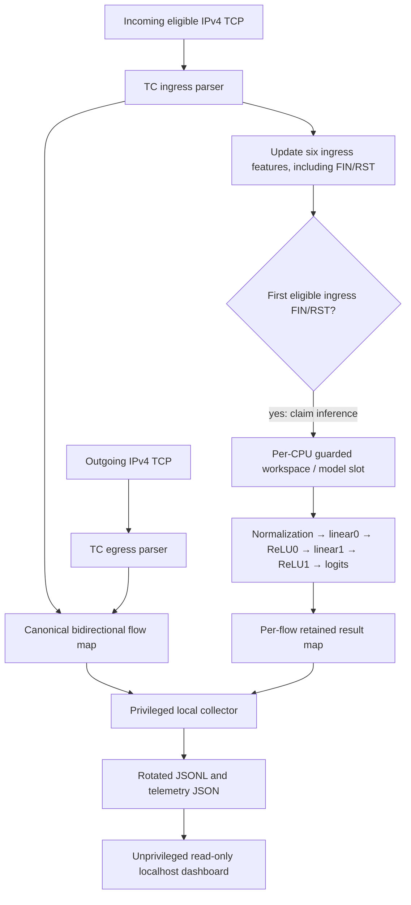

# NN-eBPF: reproduction and TC extensions

Project based on [Zhang et al., DSN 2024](https://dsn2024uq.github.io/Proceedings/pdfs/DSN2024-6rvE3SSpzFYmysif75Dkid/410500a416/410500a416.pdf) and [IntelligentDDS/NN-eBPF](https://github.com/IntelligentDDS/NN-eBPF).

We reproduce an integer neural network inside Linux eBPF and extend receive-side XDP processing to TC ingress, with TC egress monitoring and canonical bidirectional flow statistics. The bias-free **6 → 32 → 32 → 2** classifier runs normalization, three linear stages and two ReLUs across six BPF programs connected by tail calls. Our TC implementation monitors and logs; it returns `TC_ACT_OK` and **does not block attacks**.

**The deployed MLP still uses six ingress-derived features. Egress statistics are monitored, not neural-network inputs.** The separate offline CICFlowMeter bidirectional experiment is not deployed.

## Start here

- [Install, build and single-machine reproduction](docs/GETTING_STARTED.md) — no physical laptops required.
- [Models, fixed-point arithmetic and experiment reproduction](docs/EXPERIMENTS.md).
- [Two-laptop operator runbook](docs/TWO_LAPTOP.md) — Windows client and Ubuntu VM, explicit attachment only.
- [Results, evidence and limitations](docs/RESULTS.md).
- [Repository inventory and integration decisions](docs/REPOSITORY_AUDIT.md).
- [Submission validation and publication status](docs/SUBMISSION_VALIDATION.md).
- [Attribution and licensing](docs/ATTRIBUTION.md).

Commands in those guides are labeled **E** (executed successfully for this candidate), **V** (verified from code, not executed here), or **X** (external hardware/data or privileges required; not locally verified for this candidate). Historical kernel results are identified separately from current validation.

## Architecture

Five inference tail calls follow preprocessing; dispatch from the ingress entry is outside the inference-stage benchmark. Shared flow state uses synchronization; temporary inference state is per CPU. Duplicate completion attempts are counted rather than generating a fresh prediction. Collection is bounded: a finite result map is retained, not an unlimited event history. Inspect dropped/failed publication counters and rotate/restart an experiment before capacity is exhausted.

Six inputs, in order: maximum TCP-segment length; maximum ingress IAT in **nanoseconds**; minimum TCP-segment length; destination TCP port; cumulative ingress TCP-header bytes; ingress packet count. Segment lengths include TCP headers. These definitions and FIN/RST observation windows differ from similarly named CICFlowMeter CSV columns.

## Main measured results

These are separate experiments, not interchangeable claims. See [evidence and caveats](docs/RESULTS.md).

| Experiment | Recorded result | Scope |
| --- | --- | --- |
| Fresh model, 2,826 held-out reproduction rows | F1 **99.6734%**, TP 1,984 / FP 9 / TN 829 / FN 4 | Offline within-dataset, exact-vector-group split; not campaign independent |
| Original model, 13,844 scale-held-out rows | Mean final-logit absolute error **179.14× lower** with layer-specific arithmetic | Exact rational reconstruction of quantized header; not original FP32 |
| Same fresh model, paired kernel test-run | Mean **5.141 / 3.636 / 12.846 µs** for XDP Q16 / TC Q16 / TC layer-specific | 2,826 vectors × five trials, WSL2; implementation tracing/parser/telemetry costs included |
| Fresh live isolated TCP | Both hooks, six stages, retained logs, 1/10 clients, ports 80/9000 | Historical namespace/veth evidence; synthetic benign-intent false positives occurred |

Offline classification, numerical fidelity, kernel execution and live detection effectiveness are different measurements. The dashboard is real telemetry, but a printed class 1 is not evidence that an attack occurred. Synthetic benign-intent traffic was frequently classified as class 1; held-out F1 does not promise live-network accuracy.

## Source layout

| Path | Purpose |
| --- | --- |
| `src/` | Original XDP/MLP, original parameter header, authors' training scripts |
| `tc/` | TC ingress/egress, concurrency protections, ownership-aware controller, isolated tests |
| `quantization/` | Offline calibration, layer-specific integer arithmetic, references and tests |
| `validation/`, `evaluation/` | Host numerical checks, stored-vector evaluation, PCAP research and timing tools |
| `deployment/`, `dashboard/`, `demo/` | Explicit model selection, collector, read-only web UI, controlled TCP demonstration |
| `deployment/models/fresh/` | Frozen fresh-model runtime parameters, train-only scaler, calibration and pilot |
| `experiments/fresh_model_20261108/` | Fresh training/evaluation source and selected numeric artifacts |
| `experiments/xdp_final_20261108/` | Original-XDP / paired-TC kernel timing harness |
| `research/` | Separate offline CIC CSV, threshold sensitivity and earlier feasibility research |
| `docs/evidence/` | Selected historical summaries and submission validation evidence |
| `libbpf/`, `bpftool/` | Vendored build dependencies with their existing license notices |

The small authors' numeric reproduction arrays are included. CIC ZIPs and PCAPs, attack tooling, build products, virtual environments and bulk kernel logs are excluded. No dataset executables are needed. Historical development branches remain intact; this submission uses a selected source snapshot to avoid importing payload history.

No project-wide license was found in the upstream root; we do not invent one. Preserve all supplied component notices and consult [attribution](docs/ATTRIBUTION.md) before redistribution. AI assistance was used for code, analysis and documentation; students conducted operator-controlled tests and review. Evidence gaps are stated explicitly.
