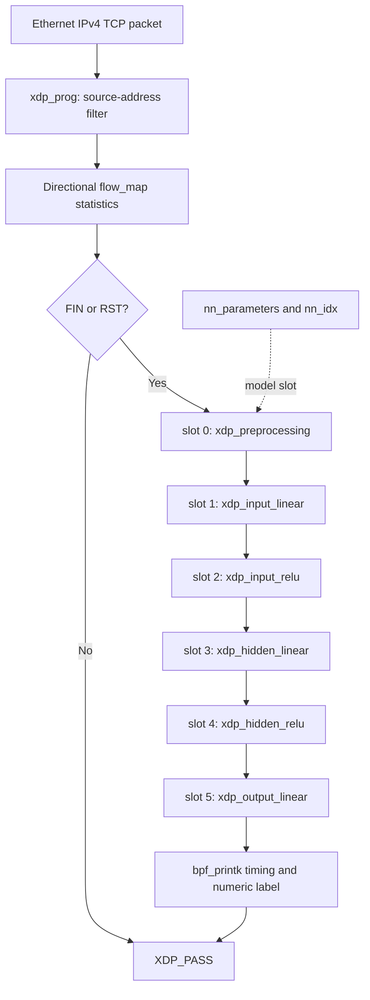

# Stage 00 — repository and VM audit

Audit date: 2026-11-06 UTC. Scope: inventory and kernel capability probing, following [the supplied execution plan](../../UBUNTU_VM_IDS_AGENT_PLAN.md). No baseline build, model training, numerical inference test, detector attachment, traffic generation, package installation or network configuration was performed.

**Gate: PASS with an explicit legacy-metadata exception.** The inventory and privileged kernel capability probe are complete. The user approved treating only the known legacy attack-tool gitlink diagnostic as nonblocking; its failure evidence and references remain intact. All later build/runtime gates remain mandatory. Stage 01 has not started. See [gate.md](gate.md) and [the recorded exception](legacy-metadata-exception.json).

## Baseline and preservation

- Starting branch: `baseline-reproduction`; new work branch: `test-env`.
- Both reference commit `65c49c737b6791801cc98d9839b930b77ff42435` (`Set up evaluation pipeline for baseline`). Branch creation did not rewrite history.
- Initial working tree had only the untracked user file `UBUNTU_VM_IDS_AGENT_PLAN.md`. Its SHA-256 remained `793066ff7fed78dae1f1926c0e46f0c4c203019c4912d9496ec22f629be9d400`.
- Current origin: `git@github.com:Arnav1410/ebpf-ids-research.git`. Local history includes `4fe55dd`, then the baseline reproduction and evaluation commits. Existing documentation attributes the original code to `IntelligentDDS/NN-eBPF`; no fetch or comparison against the current upstream HEAD was performed.
- [baseline-snapshot.json](baseline-snapshot.json) records 20 source/configuration/tool/build-product fingerprints, not binary copies or a claim of reproducible rebuilding.
- [preservation-checks.json](preservation-checks.json) records unchanged tracked worktree/index, unchanged baseline reference and fingerprints, and six unchanged before/after network snapshots. No lab resources were created.
- Evidence is intentionally separate from ignored `.output/` artifacts. No commit was made; the user plan remains untracked.

## Environment and compatibility

| Item | Observed result | Interpretation |
| --- | --- | --- |
| Guest OS/kernel | Ubuntu 22.04.5 LTS, x86-64; `6.8.0-138-generic`; signature `Ubuntu 6.8.0-138.138~22.04.1-generic 6.8.12` | Actual guest, not an assumed generic Ubuntu kernel |
| Virtual hardware | KVM; QEMU Standard PC Q35/ICH9, `pc-q35-11.1`, SeaBIOS; four visible CPUs | Host VM definition and physical bridge configuration are not available from these guest observations |
| Management network | `enp1s0`, virtio, UP, `192.168.122.20/24`; default gateway `192.168.122.1`; root `fq_codel` | Protected from experiments; the address does not prove NAT or physical bridging |
| Existing lab state | No named network namespaces; only `lo` and `enp1s0` in the link inventory | No topology or TC filters were created |
| Actual compiler | `clang-12` 12.0.1, BPF/BPFEL/BPFEB targets registered; `llvm-config-12` 12.0.1 | Matches `src/Makefile:4`; unversioned `clang` and `llvm-config` are absent, but installing aliases is unnecessary for this Makefile |
| Host build tools | Make 4.3; GCC/cc 11.4.0; libelf 0.186; zlib 1.2.11 and development packages present | Inventory only, not a fresh successful build |
| BPF tools | Vendored `.output/bpftool/bpftool`: 7.3.0/libbpf 1.3; system bpftool: 7.4.0/libbpf 1.4 | Prefer the vendored build path used by the existing project; do not silently mix toolchains |
| Network tools | ip/tc iproute2 5.15.0, linked libbpf 0.5.0; `nc` available | TC loading syntax/compatibility still needs the Stage 03 live probe |
| BTF/filesystems | Readable `/sys/kernel/btf/vmlinux`, 6,099,393 bytes; bpffs and tracefs mounted; bpffs mode 700 | BTF presence does not prove verifier or attachment success |
| Kernel configuration | BPF syscall/JIT/BTF and network namespaces enabled; TC BPF, ingress qdisc and veth configured as modules; corresponding module files found | Static support is present; modules were not loaded by this audit |
| Permissions | UID 1000, no effective/ambient capabilities; `kernel.unprivileged_bpf_disabled=2`, `kernel.perf_event_paranoid=4`, BPF JIT enabled | An operator-authorized sudo capability probe succeeded; sudo policy and BPF restrictions were not changed |
| Privileged feature probe | Initial noninteractive attempts failed; subsequent authenticated vendored probe returned 0 with empty stderr | PASS for probed capabilities: BPF syscall, XDP, SCHED_CLS, hash/array/program-array and ring/perf-event maps; not a baseline load/attachment test |
| Unprivileged alternative | Initial vendored probe returned 255 because its unprivileged mode needs libcap | Historical failed alternative; authenticated probe resolved the permission-evidence gap without a tool rebuild |
| Python/model environment | Python 3.10.12; existing evaluation venv inventory includes NumPy 2.1.3 and torch 2.5.1+cpu | Package metadata inspected; training/tests not rerun |
| Optional missing tools | `ethtool`, `iperf3` | Not installed automatically; choose/install only when a later approved stage requires them |

The selected kernel configuration, DMI observations and their read sources are in [environment.json](environment.json). Commands, complete stdout/stderr, exit codes and timestamps are in [commands.json](commands.json). Missing executables have explicit exit-code-127 records; failures are not hidden by a successful final shell command.

## Actual build and operational entry points

Root `Makefile:15-30` builds vendored bpftool and static libbpf. `src/Makefile:14-39` builds the detector and updater, derives `vmlinux.h` from the running kernel BTF, compiles `xdp.bpf.c` with `clang-12 -g -O3 -target bpf`, and generates the libbpf skeleton. Userspace links libbpf, libelf and zlib. Include paths assume x86-64.

The actual build sequence, **not executed during Stage 00**, is:

```bash
make
make -C src
```

| Path | Role |
| --- | --- |
| `src/xdp.c:37-140` | Loader: skeleton load, tail-call map setup, initial model index, explicit interface argument/default `ens3`, XDP link attachment, SIGINT lifetime, global model-pin cleanup |
| `src/.output/xdp` | Existing loader ELF; future isolated execution must pass the actual owned lab interface, not use the default or management NIC |
| `src/hot_updating.c:5-57`, `src/.output/hot_updating` | Populate inactive parameter slot and switch active index via global pinned maps |
| `run-baseline.sh` | Existing original-XDP smoke runner; owns its namespace/veth lab, validates model bytes and stages, runs TCP and consumes tracing. Not run, including its freshness/check mode |
| `evaluation/__main__.py:13-90` | Separate audit/reference/native/split/train/evaluate/kernel commands, explicit model selection and new output directories |
| `evaluation/kernel.py:187-263`, `evaluation/kernel_driver.c` | Private-map BPF test-run harness; not a live interface attachment test |
| `evaluation/tests/` | Existing behavior regressions; full discovery includes native C compilation and optional training, so it was deferred to Stage 01 |
| `src/mlp_train.py`, `src/mlp_quant.py` | Original training/export; export overwrites `mlp_params.bpf.h`. Not invoked |
| `evaluation/training.py`, `evaluation/requirements.txt` | Separate deterministic grouped-split paired-model training/evaluation; keeps original source parameters unchanged |

Generated `src/.output/xdp`, `hot_updating`, `xdp.o`, `xdp.bpf.o`, `xdp.skel.h` and `vmlinux.h` exist. `file`/`readelf` identify the object as ELF64 Linux BPF and the userspace products as x86-64 executables. File presence and format inspection do not establish rebuild success. The advertised non-default `test-mlp` target is unusable as checked out because its `test-mlp.c` prerequisite is absent.

## Detector architecture

All seven BPF entry points are `SEC("xdp")`. There is no TC hook, egress detector or structured event collector in the current source. All packet paths return `XDP_PASS`: the baseline is detect-only.



Filtering/unsupported headers and failed tail calls also pass packets; the diagram shows the successful matching-flow path. Sources: `src/xdp.bpf.c:14-323`, `src/xdp.c:28-35`, `src/handler.bpf.h:8-64`.

| Map | Existing layout and ownership |
| --- | --- |
| `flow_map` | HASH, 8,192 entries, unpinned; `src/common.h:4-39`. Directional key is four 32-bit fields `(saddr, sport, daddr, dport)`, without protocol or canonical reverse matching. Values hold counters/times, selected model index and two 32-element activation arrays |
| `progs` | PROG_ARRAY, 1,024 slots, unpinned; loader fills slots 0–5 with XDP program FDs |
| `nn_parameters` | Two ARRAY slots, 5,216 bytes each: 1,280 int32 weights and twelve int64 normalization values; pin-by-name at `/sys/fs/bpf/nn_parameters` |
| `nn_idx` | One ARRAY entry selects the active model slot; pin `/sys/fs/bpf/nn_idx` |

`src/params.bpf.h` defines model maps and layout. The updater duplicates `struct Net`, writes the inactive slot, then changes the active index. A flow snapshots a slot number at inference start; activation scratch remains in that shared flow-map value, not CPU-local storage. Every tail-called stage reparses the packet and looks up the flow.

### Preserved six-feature/Q16 contract

| Index | Feature | Source-defined units/semantics |
| --- | --- | --- |
| 0 | Maximum TCP-segment length | Bytes: IPv4 total length minus IPv4 header length, including TCP headers, not application-payload length |
| 1 | Maximum forward inter-packet gap | Nanoseconds; first packet starts with zero gap |
| 2 | Minimum TCP-segment length | Same definition as index 0 |
| 3 | Destination port | Host-order TCP port number |
| 4 | Accumulated TCP-header length | Bytes, sum of `doff * 4` |
| 5 | Packet count | Matching observed packets, including the FIN/RST that triggers inference |

The source filter is `33.33.33.73`. Normalization and the bias-free 6→32→32→2 network use static Q16 arithmetic, int64 accumulators and int32 results, without saturation. A strict score0 > score1 selects label 0; ties select 1. Numeric labels are not verified benign/attack semantics. Source-derived feature units are known; correspondence to dataset-generation semantics remains unverified.

Output is an unstructured kernel trace line with feature-update timing, inference-chain timing and a numeric label. It has no versioned endpoint/model/logit event record. It is not a ring-buffer/perf-buffer transport or a full packet/application latency measurement.

## Saved evidence versus current execution

All runtime results below are **historical**. This audit freshly checked artifact integrity, not the original execution, and did not rerun the numerical comparator or packet fixtures.

| Check | Retained evidence | Stage 00 finding |
| --- | --- | --- |
| Baseline build | Existing products; historical M4 build/freshness records | ELF formats inspected; current reproducible rebuild/freshness NOT TESTED |
| Verifier/BPF execution | `.output/evaluation/m4-root-context/{report.json,kernel.log,kernel-output.json}` | Saved pass, actual execution and zero driver exit; libbpf diagnostics plus raw outputs retained, not a full verifier-instruction transcript |
| Kernel arithmetic/packet fixtures | Same M4 files | Saved 36-vector all-stage/full-chain agreement and nine packet cases, including fragmented short-linear Ethernet; private cleanup reported complete. This is BPF test-run evidence, not live attachment |
| Live XDP attachment/TCP | `BASELINE_SUMMARY.md:182-211` | Historical narrative only; original `/tmp` logs are absent. Must reproduce during Stage 02 rather than treat the narrative as a fresh gate pass |
| Paired training/held-out metrics | `.output/evaluation/m3-train/{training.json,report.json,float-model.json,quantized-model.json,split.json}` | Saved 15,072 training / 3,768 test rows, separate portable float/integer artifacts and train-only preprocessing; the four saved artifact checksums match current bytes |
| Repeat/reload | `.output/evaluation/m3-repeat/`, `m3-reevaluate/` | Saved records exist; repeatability NOT rerun during this audit |
| Native arithmetic | `.output/evaluation/m5-native-all/report.json`, `m5-native-trained/report.json` | Saved passes with 18,844 vectors each; arithmetic-header/host-driver source checksums match current files. Reports do not hash every native executable/input |
| New accuracy/latency/throughput | None generated by this stage | NOT MEASURED |

[artifact-checks.json](artifact-checks.json) contains 26 matching checksum comparisons and three successful model identity/packing checks. These bind the saved M4 detector source/dependency/object/driver/input hashes, dataset bytes, M3 model/split exports and native-driver/header sources to current files. They do not bind every Python evaluator source or establish fresh load/attachment success.

The original model remains `src/mlp_params.bpf.h`. The independently trained model remains `.output/evaluation/m3-train/quantized-model.json`, with its own exported header. Neither was substituted for the other. No original training checkpoint was found; the M3 float JSON is a portable final-epoch parameter artifact, not a resumable optimizer checkpoint.

## Known issues and constraints for later stages

1. **Submodule metadata:** `git submodule status` returns 128 for the unmapped `dataset-instance/intrusion/DVMA/brute-force` gitlink. The index also contains the `GoldenEye` gitlink. Root `.gitmodules` only describes libbpf/bpftool; populated vendor trees are normal tracked files. Both attack-tool gitlinks are unrelated to the baseline build, but `dataset-instance/intrusion/run.sh:4,11` references them. Both checkout directories are empty, so no local submodule configuration supplies authoritative URLs. Their provenance/metadata needs explicit resolution before claiming repository-wide submodule integrity; do not initialize, clone, execute or silently remove them to make the diagnostic pass. The inspected original local commit's `.gitmodules` also lacks these mappings.
   The user explicitly approved a [narrow Stage 00 exception](legacy-metadata-exception.json) for these references. This does not repair their metadata, validate legacy attack scripts or waive any IDS build/runtime gate.
2. **Missing document:** `BASELINE_SUMMARY.md:241` links `EVALUATION_PLAN.md`, which is absent from the current checkout. Root README is also absent. This audit does not silently recreate user-deleted files or repair historical documentation.
3. **Stage 02 topology mismatch:** the plan's example `10.203.0.1` client will not satisfy the unchanged detector's `33.33.33.73` source filter. Preserve the baseline and explicitly select a conflict-checked matching lab address or its existing runner topology; do not infer missing predictions are model failure.
4. **Parsing:** fixed IPv4-header offset; no supported VLAN/IPv6/fragment/IPv4-option policy. Length/ihl/doff semantics lack complete validation. Malformed features are a source-level risk, not a failure reproduced by this stage.
5. **Concurrency/lifecycle:** compound statistics and flow-resident activations lack synchronization. Same-flow parallel updates/inference may race. No expiry/deletion/tuple-reuse reset; repeated FIN/RST can retrigger inference; failed map insertion is not observable.
6. **Model readiness/update:** loader attaches before updater initialization; no kernel readiness gate. Slot-number snapshots do not prevent later slot reuse under an in-flight reader. Updater error handling/exit codes do not establish successful map writes by themselves.
7. **Ownership:** loader/updater use global pins; loader removes them without ownership validation. Several early loader returns bypass explicit cleanup; only SIGINT is handled. Do not reuse that global-pin lifecycle as the future TC/collector contract.
8. **Numerics/training:** original exporter accepts a fractional-bit argument while execution hard-codes 16; rounding can produce invalid divisors and there is no saturation. Original trainer uses an unseeded split and fits preprocessing on the full dataset; its referenced `.pkl` checkpoint/data asset is missing. Use the existing separate paired evaluation rather than silently fixing the reference.
9. **Provenance:** dataset capture dates, training overlap of original weights, numeric-label meanings and paper-equivalent split remain unverified. Neither saved kernel parity nor offline numeric-label accuracy proves paper reproduction or production IDS correctness.

## Modular eBPF integration boundary — design constraints, not implementation

The detector is still changing. Keep the surrounding demonstration independent of its internal BPF maps, loader structs and tail-call symbols:

- **Reference variant:** retain original XDP/static parameters, loader and runner unchanged and selectable independently. Future TC/bidirectional/quantization work must not reinterpret this reference in place.
- **Hook/lifecycle boundary:** hook-specific code owns build/load/attach/detach, private resource identities and scoped cleanup. Backend consumers must not depend on the current global pin paths or default interface. No attachment to the management NIC; DETECT ONLY remains invariant.
- **Feature/model boundary:** make feature order/units, direction/orientation, model identity, parameter layout, quantization/rescale/tie semantics explicit before sharing arithmetic. RX-only weights never implicitly accept new bidirectional features. Freeze inputs and compare against the existing independent integer oracle when the relevant stage is reached.
- **State boundary:** mutable flow statistics, coherent inference snapshots/scratch and model readiness/generation need separate ownership. Do not expose today's `flow_attribute` memory layout as the dashboard API. Design synchronization in Stage 04, not by adding speculative locking during the audit.
- **Event boundary:** Stage 06 will define a versioned, bounded completion-event transport. The collector/dashboard consumes detector-produced results; it must not parse `trace_pipe` as a permanent API, calculate replacement predictions, or sit in the forwarding path. Keep later replay fixtures visibly separate from live events.
- **Dependencies:** retain the existing standalone `evaluation/` convention and explicit model selection. Do not add a plugin framework, fake backend, collector/UI scaffold, compatibility shim or new event ABI during Stage 00.

## Reversibility and continuation

No network rollback is necessary: link/address/route/namespace/qdisc snapshots are unchanged. No interface attachment, model replacement, module load or package install was requested by the executed commands. Tracked source/index remained unchanged.

To return to the preserved reference branch without discarding files:

```bash
git switch baseline-reproduction
```

Untracked evidence and the user plan remain in the working directory across that switch; it is not a deletion command. Do not use a hard reset or broad cleanup.

Stage 00 is PASS under the recorded narrow metadata exception. Stage 01 can next rebuild and validate the unchanged baseline; live reproduction remains Stage 02. No commit or later-stage execution occurred.
