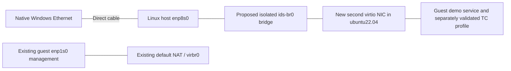

# Stage08 — proposed isolated direct-Ethernet setup

**Status: CONDITIONALLY APPROVED, NOT APPLIED. Stage08 remains BLOCKED.** The operator retained the newly observed `192.168.77.0/24` subnet and requested repeatable discovery/import rather than permanent IP assumptions. Recovery/console readiness is not established. See [physical-plan-approval.json](physical-plan-approval.json), [policy-storage-observations.json](policy-storage-observations.json) and [subnet-recovery-decision.json](subnet-recovery-decision.json).

## Diagnosis from supplied observations

- Actual host collector observes `enp8s0` (`38:a7:46:4f:4c:83`) UP/LOWER_UP at `192.168.77.1/24`, without a bridge master. Preserve this user configuration; earlier NO-CARRIER is historical.
- Actual native Windows5.1 collector observes physical `Ethernet`, index5, MAC `00:e0:4c:68:01:4c`, Up at100Mbps with preferred manual `192.168.77.2/24`, DHCP disabled and no IPv4 DNS/default gateway on the adapter.
- Both reports have zero collection errors. The ports still need peer/traffic verification; carrier and connected-route entries do not prove packet delivery. See [actual report/import review](operator-discovery-review.json).
- The VM's sole supplied NIC is `52:54:00:73:34:a0`, backed by host `vnet2` on libvirt `default`, bridge `virbr0`, forward mode NAT. Keep guest `enp1s0` / `192.168.122.20` and its existing default route unchanged.
- The full host policy output is supplied: WARP table 65743 has no matching `192.168.77.0/24` route; no table52 lab route is listed. Ordinary unmarked nonlocal `.77.x` traffic is expected to fall through to the main connected route. This is route-table analysis, not packet/firewall proof. No blanket VPN disable or rule/route flush is justified.
- Current NM profile is `enp8s0`, UUID `fe6361a5-d2e1-4012-997f-d5b161098d9a`, IPv4 manual, IPv6 ignore, state connected externally. Do not assume it is a durable saved rollback anchor or restore the stale earlier DHCP profile instead. Exact undo must preserve the actual current `.77.1` state.

## Proposed topology



No routing/NAT/Internet-sharing service is needed for this demo segment. Do not change global forwarding, default routes, management NAT or Wi-Fi/VPN settings to create it. Existing host bridge/filter policy may still affect bridged packets and must be diagnosed, not flushed.

## Address intent — observed host, proposed peers

| Role | Interface intent | IPv4 intent |
| --- | --- | --- |
| Linux host | Future `ids-br0` bridge, with `enp8s0` as its port | Keep observed `192.168.77.1/24`; move off the physical port only during approved cutover |
| Windows client | Observed physical Ethernet, index5 | Observed `192.168.77.2/24`; preserve |
| Ubuntu VM | New second NIC; actual name/MAC discovered after addition | Proposed `192.168.77.3/24`, not yet observed |

**No default gateway or DNS server on this demo segment.** The host-side IPv4 address belongs to the bridge, not simultaneously to the bridge and physical port. Preserve the guest management address/default route and Windows Wi-Fi/VPN configuration.

This subnet is distinct from the supplied management NAT, Wi-Fi, ZeroTier and WSL networks. Its current host connected route is intentional, not a collision to delete. No duplicate-address, firewall or physical connectivity proof exists yet.

Actual reports have been imported: `IDS_CLIENT_IPV4=192.168.77.2`; unknown guest demo NIC/MAC/IP remain empty. Re-run discovery when addresses/topology change. The importer records observed values and clears missing/stale targets; it never assigns the proposed guest `.77.3` or guesses an interface.

## Repeatable read-only collection

Copy `test_env/discover-host.sh` to the **Linux virtualization host**, not inside the Ubuntu VM. Copy `test_env/discover-windows.ps1` to the Windows laptop. Neither collector changes networking or needs WSL:

```bash
bash ./discover-host.sh --vm ubuntu22.04 --wired enp8s0 --uri qemu:///system
```

```powershell
powershell.exe -NoProfile -ExecutionPolicy Bypass -File .\discover-windows.ps1 -InterfaceAlias Ethernet
```

Paste each complete JSON report, or copy the saved reports into the guest and run `python3 -B -m test_env.configure --host host-discovery.json --windows windows-discovery.json --apply`. The importer also observes the actual guest now. See [configuration instructions](../../test_env/CONFIGURATION.md#repeatable-host-and-windows-discovery) for preview, saving files, incomplete reports and safety scope.

Actual collector reports are now received and validated with no collection errors. Host carrier/current profile and Windows static addressing are established by those reports; broad inventory reruns are not needed. Snapshot metadata is empty, the actual disk driver is `qcow2`, VM memory8GiB and host filesystem available92.6GiB.

Next recovery preparation is a libvirt-managed **atomic full-system internal snapshot** from the Linux host. Snapshot creation can pause the VM while writing its memory state. It has not been executed by the agent; unsupported storage/device combinations must fail rather than be forced. Sources: [virsh snapshot creation](https://www.libvirt.org/manpages/virsh.html#snapshot-create-as), [snapshot types](https://libvirt.org/formatsnapshot.html).

```bash
sudo virsh --connect qemu:///system snapshot-create-as \
  --domain ubuntu22.04 --name ids-before-stage08 \
  --description "Before isolated Ethernet bridge and demo NIC" --atomic
```

After a successful creation, inspect `virsh --readonly --connect qemu:///system snapshot-list ubuntu22.04` and establish host/virt-manager console access. Stop and report any creation error; do not remove `--atomic`, copy the active image, invoke `qemu-img` directly, or create external overlays to force it. No restore command is proposed; restoration can discard later changes. Internal snapshots share the VM image and are not independent disk-failure backups.

### What rollback and console mean

- A VM snapshot/equivalent backup is a recovery point for the VM's storage and, depending on method, possibly memory. Restoring can discard changes made since it was captured, including repository work. No restore command is issued here.
- The virt-manager guest console is the VM's screen/keyboard, independent of its IP connectivity. The Linux host also needs local console access if an experimental interface disconnects.
- A VM snapshot does **not** restore Linux-host bridge/NetworkManager settings or Windows Ethernet settings. Record those separately and prepare narrowly scoped undo commands before changes.
- Host rollback must restore the actual existing connection/profile, not delete unrelated profiles or flush routes/firewalls. Windows rollback must affect only the selected Ethernet adapter and restore its recorded DHCP/address configuration, leaving Wi-Fi/VPN untouched.

## Application and validation gates

1. Conditional bridge/second-NIC approval and `.77/24` intent are recorded. Actual collector reports and import pass their checks. Before physical changes, establish recovery/console readiness, exact network rollback and name-collision guards; then perform actual route/capture tests.
2. Prepare host and Windows network rollback from their actual current configuration. Do not delete unrelated NetworkManager profiles or replace broad firewall policy.
3. Create the isolated host bridge, use the direct-cable port only, assign its static address, and preserve management/Internet connectivity. Add a separate VM virtio NIC on that bridge without altering its NAT NIC. The exact setup commands depend on the inspected host manager/profile and are intentionally not guessed.
4. Discover the new guest NIC/MAC and assign its demo-only static address. Preserve Windows's now-observed `.77.2`/no-gateway settings rather than reassigning them unnecessarily.
5. Verify actual route/interface/source selection after configuration. Windows must choose Ethernet for the guest demo IP; Linux host must choose the demo bridge. Verify ARP/ICMP or scoped TCP as appropriate, independently capture the packets, and prove a real TCP request/response before any eBPF attachment. A ping blocked by a Public-profile rule is not grounds to disable the firewall.
6. Implement/validate a separate real-interface backend with the actual approved identities/source address. The accepted private loader remains veth-only, and its old `33.33.33.73` source filter does not match this candidate subnet. Do not change the original baseline weights/source or weaken the private guard to force success.
7. Exercise actual physical ingress/egress, feature/inference/event/UI agreement and strict owned rollback. Only then mark Stage08 PASS and commit it. No attack-detection or accuracy claim follows from simple TCP connectivity.

Latest actual guest preflight is referenced in [operator-discovery-review.json](operator-discovery-review.json): BLOCKED, only `lo`/protected `enp1s0`, missing demo NIC/MAC/IP and no accepted physical backend. Windows source `.77.2` is configured as metadata. No host/Windows interface changes, VM NIC hotplug, physical attachment, snapshot or test traffic were performed by the agent.
